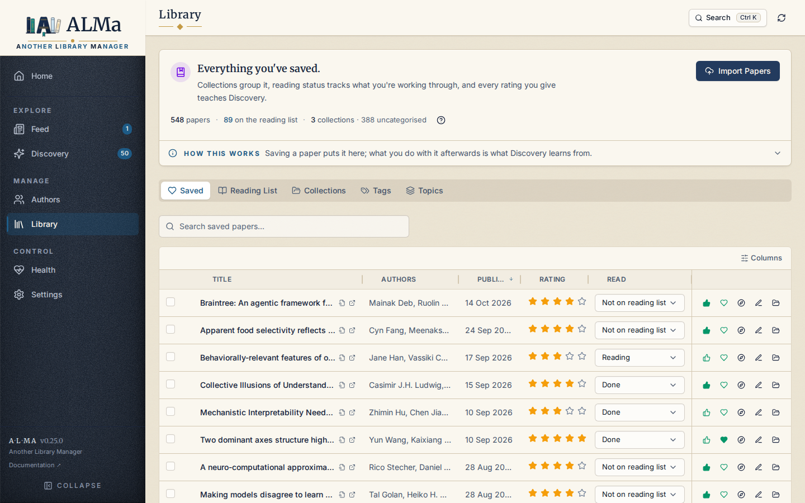

# Docker

**Docker is the recommended way to run ALMa.** The published image
pulls from GitHub Container Registry and includes the FastAPI
backend, the built React frontend, the SPECTER2 encoder (in the
`normal` variant), and every native dependency already pinned and
tested. You provide an [OpenAlex API key](https://openalex.org/settings/api)
(**required** — see [Set your OpenAlex key](#set-your-openalex-key-required)
below).

There is one way to run ALMa in production: the shipped
`docker-compose.yml`. It sets the security hardening (read-only rootfs,
`cap_drop ALL`, localhost-only port), the healthcheck, the log limits and
the `alma-data` / `alma-config` named volumes. The one-line installer is
a thin front end to it. You can also
[run the same file yourself](#without-the-installer).

Three image flavors are published: CPU (the default), `-gpu` (CUDA
torch for NVIDIA hosts) and `-lite` (no torch, for Pis). `:stable`,
`:stable-gpu` and `:stable-lite` move only on a release, and are what a
new install follows. `:latest`, `:latest-gpu` and `:latest-lite` move
with every push to `main`, so they can carry unreleased work.

## Install

The fastest install is the cross-platform `setup.sh` / `setup.ps1`
script. It checks Docker, auto-detects your hardware (NVIDIA GPU vs
Raspberry Pi vs generic CPU host), picks the right image tag, and starts
ALMa through Compose. After it boots, add your OpenAlex key
in **Settings → Connections** (see [Set your OpenAlex key](#set-your-openalex-key-required)).

=== "Linux / macOS"

    ```bash
    curl -sSL https://raw.githubusercontent.com/costantinoai/alma-library-manager/main/setup.sh | bash
    ```

=== "Windows (PowerShell)"

    ```powershell
    irm https://raw.githubusercontent.com/costantinoai/alma-library-manager/main/setup.ps1 | iex
    ```

Open <http://localhost:8000>.

What this does:

* Creates `~/alma-docker` (set `ALMA_HOME` to choose another folder)
  with the Compose files and a private `.env` that holds your settings.
  Every later run reads them, so nothing you set gets lost.
* Pulls the image for your hardware (multi-arch: `linux/amd64` and
  `linux/arm64`). Anything already running keeps running until the pull
  has succeeded.
* Creates two **Docker named volumes** (`alma-data`, `alma-config`)
  that survive container removal and image upgrades. They live under
  `/var/lib/docker/volumes/<name>/_data` on Linux, or under the
  Docker Desktop VM elsewhere.
* Binds ALMa to `127.0.0.1` only. Nothing is exposed to your
  network. ALMa has no login, so keep it that way or use a private
  network; see [Deployment](../operations/deployment.md).
* Waits until ALMa reports healthy, and fails if it does not.

The installer reads these from the environment and saves them in
`.env`. A value you pass on a later run replaces the saved one.

| Variable | Default | Purpose |
|---|---|---|
| `ALMA_ALLOWED_ORIGINS` | empty | Addresses you open ALMa at, other than `localhost` or an IP. See [Open ALMa from your phone](../operations/deployment.md#open-alma-from-your-phone-or-another-device). |
| `BIND_ADDR` | `127.0.0.1` | Host address for port 8000. See [Exposing on your network](#exposing-on-your-network). |
| `ALMA_IMAGE_TAG` | `stable`, plus the flavor suffix | The exact image tag. `0.25.0`, for example. |
| `ALMA_VERSION` | `stable` | The version or channel. The flavor suffix is added for you. |
| `ALMA_FLAVOR` | the saved flavor, else autodetected | `cpu`, `gpu` or `lite`. |
| `OPENALEX_EMAIL` | empty | Optional contact email (sets a courteous User-Agent). |

For example:

```bash
curl -sSL https://raw.githubusercontent.com/costantinoai/alma-library-manager/main/setup.sh \
  | ALMA_ALLOWED_ORIGINS=https://alma.your-tailnet.ts.net bash
```

`.env` holds anything else ALMa reads from its environment, such as
`ALMA_CPUS`, `ALMA_MEMORY` or `ALMA_BACKUP_RETAIN`. To add your own
Compose settings, put them in `docker-compose.override.yml` in the same
folder. The installer replaces `docker-compose.yml` on every run, but
it keeps your override and adds it to the stack.

### Without the installer

The installer does nothing you cannot do by hand:

```bash
mkdir ~/alma-docker && cd ~/alma-docker
curl -fsSLO https://raw.githubusercontent.com/costantinoai/alma-library-manager/main/docker-compose.yml
touch .env && chmod 600 .env     # add settings here, one NAME=value per line
docker compose pull
docker compose up -d --wait
```

For the GPU flavor, also fetch `docker-compose.gpu.yml` and add these
lines to `.env`:

```bash
ALMA_IMAGE_TAG=stable-gpu
COMPOSE_FILE=docker-compose.yml:docker-compose.gpu.yml
```

Use `ALMA_IMAGE_TAG=stable-lite` on a Raspberry Pi. Pin a release with
`ALMA_IMAGE_TAG=0.25.0`.

Pass `docker-compose.override.yml` on `COMPOSE_FILE` too if you have
one: Compose only loads it by itself when `COMPOSE_FILE` is not set.

Then add your OpenAlex key in **Settings → Connections**.

### Set your OpenAlex key (required)

OpenAlex requires an API key on every request (since 2026-02-13) — a
keyless install gets 100 credits/day, then HTTP 409. A free key takes
~30s at [openalex.org/settings/api](https://openalex.org/settings/api).
A [Semantic Scholar key](https://www.semanticscholar.org/product/api)
is strongly recommended too (without it S2 shares the anonymous pool and
429s often, stalling Discovery).

The **recommended** way under Docker: boot the container, open
**Settings → Connections**, paste your key(s), and **Save connection
settings**. ALMa persists them to its secret store inside the
`alma-data` named volume (`secrets.json`, plain JSON with mode `600`,
**not encrypted**) — they survive restarts and image upgrades, and never
appear in `docker inspect` or your shell history. Treat any backup of
the volume as a credential.

Prefer to bake them in at launch instead (e.g. headless/non-interactive)?
List `OPENALEX_API_KEY=...` (and `SEMANTIC_SCHOLAR_API_KEY=...`) in
`.env`, which compose passes through `env_file:`. Note these are
visible to `docker inspect`, and they win over the Settings UI on every
start.

### What "persistent" actually means here

The `alma-data` volume is the only thing that holds your library —
`scholar.db` (SQLite) plus its WAL/SHM files, embedding caches, the
backups directory, and any imported BibTeX/Zotero state. The
`alma-config` volume holds plugin configs (e.g. Slack channel
mappings). These survive:

* `docker compose down` (without `-v`) and removing the container
* A newer image
* Restarts and reboots

They do **not** survive `docker volume rm alma-data` — that's the
only command that wipes your library.

If you ever want a copy on the host filesystem (for backup or
inspection), use the **Settings → Library Management → Backup** button,
which writes a gzipped SQLite file into the volume's `backups/`
subdirectory, then [pull that snapshot out](#backups). To download a
full copy instead, use `curl -o alma-backup.db
http://localhost:8000/api/v1/backup/export`. Never copy `scholar.db`
out of the volume while ALMa runs: writes can land during the copy and
leave it damaged, and it misses whatever is still in the WAL.

### Upgrade

Re-run the installer. It pulls the new image while the old container
keeps running, then replaces the container and waits for health. If the
pull fails, nothing has stopped.

By hand, the same thing:

```bash
cd ~/alma-docker
docker compose pull
docker compose up -d --wait
```

Your data lives in the volumes, so the swap does not touch it. A newer
release may migrate the database, and an older release then refuses to
open it, so take a [backup](../operations/backups.md) first if you may
want to go back.

### Automatic updates with Watchtower

[Watchtower](https://containrrr.dev/watchtower/) updates ALMa like any
other container. It pulls the tag the container runs and recreates the
container with the same settings, so `ALMA_ALLOWED_ORIGINS` and
everything else in the container's environment stay in place. Follow
`:stable`, not `:latest`, if you want releases only.

Watchtower copies the running container, so it does not read `.env`. A
setting you change there takes effect the next time you run
`docker compose up -d --wait` in that folder.

### Moving from an older install

Earlier versions ran ALMa with `docker run`. Re-run the installer once.
It finds the old `alma` container, keeps its settings (the environment
you gave it, a LAN binding, and the image channel, so a `:latest`
install stays on `:latest`), writes them to `.env`, pulls, and only then
replaces the container. The volumes are the same ones, so your library
carries over. The container moves to the hardening in
`docker-compose.yml`, including a 4 GB memory limit. Set `ALMA_MEMORY`
in `.env` if you need more.

A checkout that ran `docker compose up` earlier owns its container
under the folder's name. Stop that container with `docker compose down`
in the checkout (without `-v`) before you start the new one, or re-run
the installer, which replaces it after the pull.

## Build the image yourself

`docker-compose.yml` never builds. To run your own checkout, layer the
developer overlay:

```bash
git clone https://github.com/costantinoai/alma-library-manager.git
cd alma-library-manager
cp .env.example .env
docker compose -f docker-compose.yml -f docker-compose.build.yml up -d --build

# GPU build with passthrough
ALMA_TORCH_VARIANT=cuda docker compose -f docker-compose.yml \
  -f docker-compose.build.yml -f docker-compose.gpu.yml up -d --build

# Lite build
ALMA_VARIANT=lite docker compose -f docker-compose.yml \
  -f docker-compose.build.yml up -d --build
```

Update with `git pull`, then the same `up -d --build`.

### Resource limits

`docker-compose.yml` caps the container at **4 GB RAM** and leaves CPU
uncapped. Override per host in `.env`:

```bash
ALMA_MEMORY=1G      # Raspberry Pi
ALMA_CPUS=2.0       # any core count your host has
```

Then run `docker compose up -d --wait`.

### File ownership

The image runs as a non-root `appuser` (UID `10001`, GID `10001`).
The **named volumes** (`alma-data`, `alma-config`) are owned by
`appuser`, so there is **no host-vs-
container UID mismatch** and nothing to configure. This is the cause of
the "permission denied" failures that plagued host bind-mount setups
(where writes to the DB / secrets / settings would fail if the host
files were owned by a different uid).

Initial credentials can come from `.env` via the `env_file:` directive
(compose reads the host file and injects the values as environment
variables — no in-container file read needed). A value there overrides
the Settings UI on every start, so leave provider keys out of `.env`
unless you mean to manage them there. Keys you save in the Settings UI
persist to the secret store **inside the `alma-data` volume**, the
canonical path for named-volume installs, so they survive restarts and
upgrades.

### Advanced: host bind-mounts

Prefer host-visible folders you can browse/back up directly? Drop a
`docker-compose.override.yml` next to the compose file (the installer
keeps it in the stack) that replaces the named volumes with binds:

```yaml
services:
  alma:
    volumes:
      - ./data:/app/data
      - ./config:/app/config
```

Then `mkdir -p data config` before `up -d`. The trade-off is the
permission caveat the named volumes avoid: the host `./data` files must
be writable by the container's `appuser` (UID `10001`). If you see
"permission denied" on the DB / secrets, `chown -R 10001:10001 data
config` (rootless Docker remaps this to your subuid range) or run a
one-off `docker run --rm -u 0 -v "$PWD/data":/d alpine chown -R 10001:10001 /d`.

## Three image flavors

ALMa publishes three flavors; all of them run every feature in the
app — only the bundled embedding stack differs.

| | `normal` CPU (default) | `normal` GPU | `lite` |
|---|---|---|---|
| Tag | `:stable`, `:0.20.1` | `:stable-gpu`, `:0.20.1-gpu` | `:stable-lite`, `:0.20.1-lite` |
| Compressed image | ~1.4 GB | ~3.2 GB | ~1.2 GB |
| Peak runtime memory | ~2 GB | ~3 GB (more on GPU init) | ~1 GB |
| Local SPECTER2 encoder | yes (CPU) | yes (CUDA when host GPU is exposed; CPU otherwise) | no |
| Semantic Scholar pre-computed vectors | yes | yes | yes |
| OpenAI / cloud embedding provider | configurable | configurable | configurable |
| Discovery / Insights graph / clustering | yes | yes | yes |
| BibTeX / Zotero import | yes | yes | yes |
| Architectures | amd64 + arm64 | amd64 only | amd64 + arm64 |

The CPU flavor is the default so users without a GPU only
download the small image. GPU users explicitly opt in via the `-gpu`
suffix (or let `setup.sh` autodetect — see below). Pick `lite` on a
Raspberry Pi or any host where 1.5 GB of `torch` on disk is precious.

### GPU acceleration

Two pieces are required to reach a host GPU from inside the container:

1. **Host-side**: an NVIDIA GPU plus the
   [NVIDIA Container Toolkit](https://docs.nvidia.com/datacenter/cloud-native/container-toolkit/)
   registered as a Docker runtime.
2. **Image-side**: the `-gpu` tag (it ships the CUDA torch wheel; the
   default CPU tag doesn't, so passthrough won't help).

The installer sets both up when it finds a GPU. By hand, see
[Without the installer](#without-the-installer).

Verify the container saw the GPU:

```bash
docker exec alma python -c "import torch; print(torch.cuda.is_available())"
# Expect: True
```

If `False`, the runtime device-resolver in
`discovery.similarity.SpecterEmbedder` silently falls back to CPU and
the rest of the app still works — GPU passthrough is purely an
acceleration. Common reasons for `False`: you pulled the CPU tag
instead of `:stable-gpu` (no CUDA wheel in the image), or the
NVIDIA Container Toolkit isn't installed on the host.

### Building locally with a chosen torch wheel

The [build overlay](#build-the-image-yourself) defaults to the CPU
torch wheel (matching the published CPU tag). To build the CUDA flavor
from this checkout:

```bash
ALMA_TORCH_VARIANT=cuda docker compose -f docker-compose.yml \
  -f docker-compose.build.yml build alma
```

`TORCH_VARIANT` accepts `cpu` or `cuda` and is ignored when
`ALMA_VARIANT=lite` (lite installs no torch at all).

## Where everything lives on disk

All state lives in two **named volumes** (`alma-data`, `alma-config`),
owned by the container's `appuser`. The deployment itself lives in
`~/alma-docker`: the Compose files and `.env`.

### 1. The library (`scholar.db`)

The single SQLite file with every paper, author, lens, feedback event,
and the on-disk citation graph. **The most important thing to back up** —
losing it means losing your library. Lives in the **`alma-data`** volume
at `/app/data/scholar.db`. On Linux the bytes are at
`/var/lib/docker/volumes/alma-data/_data/scholar.db` (root-only — no need
to touch directly); on Docker Desktop (macOS / Windows) they're inside
the LinuxKit / WSL VM, reachable via
`docker run --rm -v alma-data:/d alpine ls /d`.

### 2. Secrets and runtime knobs (`.env` values)

API keys (OpenAlex required, Semantic Scholar recommended), optional
contact email, Slack tokens, optional `API_KEY`. Initial
values are passed as environment variables through the `.env`
`env_file:`. Keys you
add or rotate in the Settings UI persist to the **secret store inside the
`alma-data` volume** (`secrets.json`) — the canonical path for named-
volume installs — so they survive restarts and upgrades with no host
`.env` write-back and no chmod games.

### 3. Bootstrap settings (`settings.json`)

A small JSON file (optional OpenAlex contact email, SQLite path). Almost everything
user-tunable from the UI (Discovery weights, AI provider, scheduler
intervals) is written to the `discovery_settings` table inside
`scholar.db`, so this file is mostly cosmetic. The image pins
`ALMA_SETTINGS_PATH=/app/data/settings.json`, so it lives **inside the
`alma-data` volume** and survives removing the container and upgrades.

### 4. Plugin configs

Slack channel mappings, etc. In the **`alma-config`** volume at
`/app/config/`.

### Quick reference

```
container                  where it lives
────────────────────────   ─────────────────────────────────
/app/data/scholar.db       alma-data volume
/app/data/secrets.json     alma-data volume
/app/data/settings.json    alma-data volume (ALMA_SETTINGS_PATH)
/app/data/backups/         alma-data volume
/app/config/               alma-config volume
.env values                env vars (env_file:)
```

What's **never** on the host (lives only inside the image, replaced on every pull):

* Python dependencies — `/opt/venv/` (~1 GB on `normal`)
* The frontend bundle — `/app/frontend/dist/`
* The `alma` Python package source — `/app/src/`

This is why pulling a newer image is safe: you're replacing
the code, not your data.

### Inspecting volumes from the host

Even on Docker Desktop where the volume isn't directly mountable, you
can always shell in:

```bash
# list everything in the data volume
docker run --rm -v alma-data:/d alpine ls -la /d

# read a file out of the volume (e.g., latest backup)
docker run --rm -v alma-data:/d -v "$PWD":/out alpine \
  cp /d/backups/scholar_<timestamp>.db.gz /out/

# disk usage
docker run --rm -v alma-data:/d alpine du -sh /d
```

## Exposing on your network

ALMa binds to `127.0.0.1` by default — reachable only
from `http://localhost:8000` on the host. ALMa has **no login**, so
this is the deliberate secure default.

For a **headless always-on box — e.g. a Raspberry Pi you run 24/7 and
open from a laptop** — set `BIND_ADDR` to bind other interfaces. The
installer saves it in `.env`; by hand, add it there and run
`docker compose up -d --wait`:

```bash
curl -sSL https://raw.githubusercontent.com/costantinoai/alma-library-manager/main/setup.sh \
  | BIND_ADDR=192.168.1.50 bash
```

Then reach it from your laptop at `http://<pi-lan-ip>:8000`
(`hostname -I` on the Pi prints its address). `:stable-lite` is the
right image for a Pi.

!!! warning "No login — private networks only"
    Anyone who can reach the port can read and change your library, so
    only do this on a private LAN, and never forward the port to the
    internet. Prefer binding to the Pi's LAN IP
    (`BIND_ADDR=192.168.1.50`) over `0.0.0.0`, and restrict the port
    with a host firewall. `API_KEY` is no help here: it
    [breaks the web app](../operations/deployment.md#api-key).

!!! note "Opening it by name"
    An IP address works as is. If you open ALMa by a hostname
    (`http://raspberrypi.local:8000`), add it to
    `ALMA_ALLOWED_ORIGINS`, or ALMa will refuse it. See
    [Open ALMa from your phone or another device](../operations/deployment.md#open-alma-from-your-phone-or-another-device).

## After it starts

Open <http://localhost:8000>. The first run lands you on the Library
page with no papers, no followed authors, nothing in the Feed. Three
things, in order, before the app becomes useful — see the
[first-run checklist](first-run.md).



## Lifecycle commands

```bash
docker logs -f alma                  # tail logs
docker exec alma /opt/venv/bin/alma --help    # invoke CLI inside container
docker stop alma                     # graceful stop
docker compose down                  # in ~/alma-docker: stop + remove (data persists in volumes)
docker volume ls | grep alma         # check what's stored
```

## Backups

The `data/` directory is the source of truth. The fastest backup
path is the **Settings → Library maintenance → Backup** button, which
writes a gzipped, transactionally-consistent SQLite snapshot into
`data/backups/scholar_<timestamp>.db.gz`. By default, only the last
five snapshots are kept (override with `ALMA_BACKUP_RETAIN=20` in `.env`).

To pull a snapshot out of the volume to the host:

```bash
docker run --rm -v alma-data:/d -v "$PWD":/out alpine \
  cp /d/backups/scholar_<timestamp>.db.gz /out/
```

See [Backups](../operations/backups.md) for the full strategy
(retention, cron, and the offline restore).

## Troubleshooting

**Container exits immediately on first run.**
Check logs for the actual error: `docker logs alma`. Common causes:

* OpenAlex 503s during startup probe — usually clears within a
  minute; the container has a healthcheck that retries.
* Permission errors only happen if you opted into host bind-mounts via
  an override — see [Advanced: host bind-mounts](#advanced-host-bind-mounts).

**The page shows `UnknownHostRefused`, or saves fail with `403`.**
ALMa does not know the address you opened it at. See
[Open ALMa from your phone or another device](../operations/deployment.md#open-alma-from-your-phone-or-another-device).

**Browser shows "broken image" icons in the sidebar.**
Update ALMa — versions before v0.9.2 had a static-asset
routing bug where `/brand/*.svg` returned the SPA index.

**`docker pull` hangs or times out on arm64.**
Multi-arch manifests can be slow to fetch over poor networks. Pin
the architecture explicitly:

```bash
docker pull --platform linux/arm64 ghcr.io/costantinoai/alma-library-manager:stable
```

**The pull says "image not found" or "401 Unauthorized".**
The package is public; if you see a 401 the most likely cause is a
stale stored credential. Run `docker logout ghcr.io` and retry.
