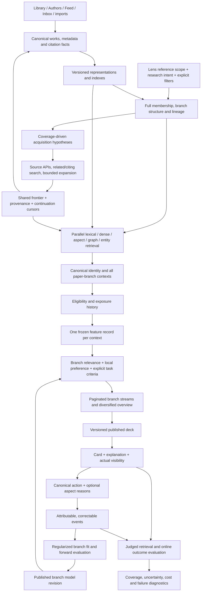

# Discovery design and method decisions

**Design revision: 2026-09-24. Proposed, not implemented or empirically validated.**
This is the authoritative target design for task 92, replacing the earlier
component proposal on this page. The [code map](discovery-current-state-map.md)
records the implementation; the [audit](discovery-scope-and-learning-audit.md)
records historical measurements. Algorithm choices below are recommendations
for ALMa's single-user, sparse-feedback setting, with a named alternative and
acceptance gate where the available evidence cannot decide the winner.

## 1. Objective and corrections to the earlier proposal

Discovery should help the user find **useful, previously unencountered research
and useful connections between research**, including outside the local corpus,
with a small attention budget. Useful can mean solving a research question,
finding a method, comparing evidence, finding a dataset, or broadening a field.
It cannot be reduced to similarity to the average saved paper, citation count,
or probability of pressing Save. Collection completion is a distinct lens
objective because a useful candidate may already be saved elsewhere.

The system needs a persistent model of *what a paper contains*, *what the
current research context requires*, *what is known about preference there*,
and *what the system still needs to investigate*. These have separate owners.
The following corrections supersede weaker statements in earlier planning:

- A lens needs a **reference scope and a search intent**. Its reference papers
  describe the starting context; they are not the only allowed candidates.
- Branches are navigable structural regions with several facets. One centroid
  and one hard partition cannot encode every useful scientific relationship.
- Complete membership does not require using every member as a network query.
  Every member contributes to structure; query exemplars are a measured,
  coverage-preserving summary, with an expandable budget.
- Broad-topic similarity, method applicability, novelty to the user, evidence
  properties and user preference are different quantities. There is no honest
  universal scientific-quality number derived from venue and citations.
- A single explicit rating or selected aspect is usable evidence. Opposite
  ratings are valuable for contrast, but a pre-existing pair is not required
  before recording or using direct feedback. Unseen papers are not negatives.
- Joint fitting can account for correlated signals; a ban on using correlated
  views would throw away useful evidence. Uncalibrated independent bonuses and
  repeated supervision from the same action are the problem to remove.
- Random display slots do not eliminate voluntary-rating bias. Actual visibility,
  ranking-policy probability and probability of supplying a judgment differ.
- Structural exploration and statistical uncertainty need separate controls.
  A distant paper can be irrelevant; an uncertain paper can be a familiar topic.
- D26 permits learning within a branch and forbids global preference transfer.
  The initial acquisition schedule is structural and coverage driven; this
  proposal does not silently introduce a learned cross-branch allocation policy.

## 2. Product objects and their scope

| Object | Meaning and source | Allowed influence |
|---|---|---|
| Canonical work | Deduplicated root paper plus version relations, metadata and provenance | Shared facts for all ALMa surfaces; preprint/published duplicates remain one recommendation identity under the existing lifecycle contract. |
| Representation | Model-versioned document vector, phrases, entities, aspect spans/vectors and typed graph edges | Shared, preference-free measurement. A source, model or extraction version travels with each value. |
| Lens | Reference predicate, optional research question, discovery objective, explicit candidate filters and manual directions | Determines the task and eligible universe. Reference membership and candidate eligibility are different predicates. |
| Branch | Stable structural region of that lens, with members, multiple exemplars, facet descriptors and lineage | Own search context and independent taste. Primary membership supports accounting; soft affinities and overlapping candidate contexts preserve bridges. |
| Facet | A text-grounded problem, method, population/material, dataset, finding or other typed aspect | Enables exact matching, aspect similarity, explanations and reason feedback. It is not necessarily another branch or learned preference. |
| Acquisition hypothesis | Branch + facet/relation + query/seed + source + traversal/page budget | A testable way of looking for missing useful papers, with lineage to the original branch. |
| Candidate context | Canonical work × branch × immutable intent/structure revision | One score and evidence record; the same work may have several valid contexts. |
| Preference event | Explicit judgment or instruction with shown branch, work, offered options, timestamp and supersession | Updates only that branch's supported effects; global Library ratings do not automatically enter every branch containing the work. |
| Deck | Versioned selection of candidate contexts with policy, positions and known selection probabilities | Display and replay. Old scores and reasons remain fixed after metadata or taste changes. |
| Branch model | Fixed shipped prior plus locally learned, regularized effects and uncertainty | Ranking within that branch. No global learned intercept, calibration or feature-weight prior can covertly transfer taste. |

A reference lens can contain all 12,000 eligible papers; there is no 500-member
ceiling. Seed has three meanings that code must stop conflating: **reference
member**, **retrieval exemplar**, and **explicit preference example**. A member
may participate in structure without a rating; an exemplar is chosen for
coverage; a preference example needs an attributable explicit verdict.

A collection membership change legitimately changes its structural input on
the next structural refresh. Changing a rating alone does not. Save therefore
has two recorded effects: membership may change an eligible reference set,
while the preference event remains attached to its shown context. A new branch
gets the fixed shipped prior and its own structural relevance, with no inherited
personal taste. Ambiguous branch splits/merges start cold under D26; historical
events retain their original branch and can still be inspected.

## 3. Whole lifecycle and dependency graph



No arrow from learned taste to shared representation or branch geometry.
Network work and local deck refresh are separate jobs. A manual request can
start acquisition and later publish another deck, while the last completed
deck remains usable. “Refresh,” “search further” and “rebuild branches” have
different triggers; they are not interchangeable names for a full rebuild.

## 4. Represent papers at the detail the user can care about

Store compatible **full document vectors**, sparse lexical/phrase indexes,
canonical entities and graph relations. Add a typed aspect layer: problem,
method, data/population/material, findings, limitations and work type, where
these can be supported by a source span. Methods must distinguish “uses X,”
“compares against X” and “finds a limitation of X” when the text supports that
relation. Mere word occurrence cannot establish stance or applicability.

Start with title/abstract phrases, source topics, structured metadata and
source-linked sentence spans. Use full text when available and useful; absence
of a PDF must not exclude a paper. Preserve spelling/acronyms alongside
normalized aliases. An author-name string is not a canonical author ID; keep
identity confidence, and do not generalize across namesakes. Venue identity
should survive abbreviations and name changes. Topic hierarchies and synonyms
support smoothing and retrieval, not automatic expansion of a user's negative
verdict to every related term.

The initial CPU path uses BM25/phrase matching and existing stored vectors.
**Aspect vectors are the first optional representation challenger**: encode
method/problem/result spans once in background, use late interaction to match
relevant spans, and display the matched evidence. They need a suitable encoder;
feeding a sentence to the document encoder does not establish correct aspect
semantics. ASPIRE demonstrates scientific sentence-aspect matching and compares
single-match and optimal-transport matching; it motivates this experiment but
does not prove gains for this Library or its fields.
[ASPIRE](https://aclanthology.org/2022.naacl-main.331/).

SPECTER2 remains a baseline with existing coverage, rather than an assumed
permanent winner. Its task adapters mean that model identity must include
adapter, query/document role, input preprocessing and normalization, not just
dimension or a generic “SPECTER2” name. No cosine comparisons between unrelated
spaces. Evaluate a modern general encoder and a scientific aspect encoder on
ALMa's tasks before switching the corpus model; dimension reduction and
quantization each get their own quality comparison.
[SciRepEval/SPECTER2](https://aclanthology.org/2023.emnlp-main.338/).

Every feature stores value/ID, source span or metadata origin, role, confidence,
model/extractor version and missingness. A bounded set of plausible display
reasons is selected from this record, not generated retrospectively from the
user's rating. Do not label a latent ICA coordinate “method X” without evidence.

Acquisition and enrichment use separate budgets. First resolve identity and
cheap metadata; then recover an abstract or citation relation for a promising
but uncertain lead; obtain full text/aspect vectors only where useful. A missing
abstract is a reason to investigate, not a negative taste feature. Record
representation uncertainty separately from uncertainty about preference and
incomplete provider coverage: asking the user cannot repair a missing DOI,
and another embedding cannot resolve an ambiguous preference between coauthors.
Enrichment can publish a better representation for the next deck without
blocking the current local refresh or rewriting its frozen evidence.

## 5. Structural branches: complete, stable, multiple interests

The recommended structural candidate is a sparse neighbourhood graph over
compatible document representations with **typed** lexical and citation links.
Use high-dimensional similarities; no 2-D map geometry. Initially, semantic
neighbours define the core graph; lexical neighbours can cover papers without
vectors, marked with lower assignment confidence. Citation links remain
separate retrieval evidence unless adding them to structure passes an ablation.
Author and venue identity should not dominate topic partitioning.

Compare graph communities (Leiden with an explicit resolution objective) with
the existing UMAP/HDBSCAN pipeline and a simple cosine-based clustering
baseline. Leiden is a candidate because its connected-community guarantee is
relevant to a graph representation; that guarantee says nothing by itself about
scientific coherence or temporal stability. Choose on neighbourhood preservation,
facet coverage, human-readable coherence, small-change identity churn,
no-vector coverage and cost, not just silhouette or number of clusters.
[Leiden](https://www.nature.com/articles/s41598-019-41695-z).

This stage runs only when reference membership, representation or structural
settings change. Maintain all member IDs and all unresolved IDs. Cluster count
is not fixed at six; allow a single coherent branch, navigation grouping, and
an explicit unresolved region. Preserve broad/narrow structural levels without
letting changing a display zoom create new learned scopes. Creating an actual
new branch is an explicit structural transition with D26 cold-start semantics.

Within each branch, choose **several representative exemplars and distinctive
facets**. A greedy coverage objective can select exemplars that add uncovered
neighbourhoods; validate coverage against the full member set. Increase the
exemplar budget until marginal coverage gain is small or an explicit resource
budget is reached, rotating unexplored areas across jobs. Do not choose the
highest-rated or most cited papers as the structural summary. Score candidate
similarity against relevant exemplars/aspects rather than collapsing the
branch to one average vector. Keep the full set available for exact comparison
and measure approximation error.

No fixed count of seeds is scientifically correct for every lens. A coherent
small branch may need very few exemplars; a broad branch needs more. The
contract is full reference coverage and bounded measured approximation, not
“500,” “six branches,” or “every member causes a provider request.”

## 6. Acquisition: search hypotheses, expansion and stopping

For each active branch, plan several concrete hypotheses:

| Hypothesis | Evidence and query | Expected benefit / principal failure |
|---|---|---|
| Core problem | Distinctive problem phrases and representative papers | High topical recall; can repeat established material. |
| Method transfer | Method facets combined with a different domain or dataset | Useful cross-field ideas; whole-document cosine can miss them. |
| Alternative method | Same problem with complementary methods | Broadens approach; must preserve task applicability. |
| Citation neighbourhood | References, citing papers, co-citation and normalized coupling | Connected developments and background; citation age/popularity bias. |
| Entity expansion | Canonical authors, venues, datasets or techniques relevant to the branch | Finds systematic omissions; requires a content check to avoid back-catalogue flooding. |
| Boundary/bridge | Papers related through one or more declared facets near another region | Serendipity grounded in a known connection; graph hubs can create false bridges. |
| Fresh or under-covered region | Date slices and poorly covered facets/sources | Avoids old/popular domination; “new to ALMa” does not establish useful novelty. |

Start with deterministic query compilation from verified phrases/IDs and
bounded citation snowballing. Query expansion retains the root intent, records
the connecting aspect, deduplicates visited works and enforces depth, source,
time and call budgets. A retrieved paper used for further search is a search
lead, never an automatic positive preference or new structural member.
Branch/source queues use fair scheduling with a documented coverage floor;
resume stored provider cursors and rotate branches rather than abandoning
those beyond a fixed display count.

A coverage ledger records attempted hypotheses, pages, source errors, unique
new works, duplicates, metadata availability and next continuation. Prioritize
by uncovered facets, source availability and marginal eligible yield per cost.
Keep delayed explicit usefulness outcomes as evaluation; do not silently pool
branch preferences to train the scheduler. Stop or defer after repeated
saturation, source exhaustion or the declared resource budget, preserving the
reason and continuation state. This permits breadth beyond 500 without an
unbounded network crawl. Do not remove all age limits blindly: make recency
part of intent, with a separate route for older foundational literature.

An optional LLM can propose grounded expansions, extract aspects or rerank a
small ambiguous set after local retrieval. It must name corpus concepts/source
spans, have a bounded cost, and fall back to deterministic queries. It must not
invent bibliographic identity, labels or taste. SemRank supports testing a
corpus-grounded concept index; Chain of Retrieval supports testing aspect-led
multistep acquisition. The latter also reports extra cost from deeper search
and repeated model calls. Neither is a justification for making an LLM loop
mandatory on a Pi.
[SemRank](https://aclanthology.org/2025.findings-emnlp.108/),
[Chain of Retrieval, v3](https://arxiv.org/html/2507.10057v3).

## 7. Retrieval, fusion and score semantics

Use independent retrieval views with distinct failure modes: BM25/phrases,
document-vector exemplars, optional aspect-vector matching, citation paths,
and structured entity/facet queries. Search corpus and frontier with the same
candidate identity contract. Apply cheap membership/explicit-filter checks
before truncation; resolve uncertain identity before final selection. Preserve
all paper–branch hit contexts, including candidates useful to several branches.

RRF is the initial candidate-pooling baseline, with per-family normalization
so adding near-identical query variants does not manufacture independent
support. It is not inherently optimal and it should not become an additional
personal reward after the same raw similarities are scored. Compare normalized
score fusion on a judged development set. Research finds cases where convex
fusion outperforms RRF, so choose using local held-out recall and ordering,
including missing-view and sparse-query cases.
[Hybrid fusion analysis](https://arxiv.org/abs/2210.11934).

For ranking, the preferred first model is a **regularized additive content
model with a fixed relevance prior and branch-local residuals**. Its small
number of feature groups is fixed; the exact values are sparse and extensible:

```text
s_b(p) = r0(intent_b, exemplars_b, facets_b, p)
       + delta_b · relevance_features(b, p)
       + sum_v theta_b,v * value_feature(v, p)
       + w_b · normalized_document_embedding(p)
```

`r0` is the shipped, fixed, task-appropriate relevance model. `delta_b` adapts
relevance families only after sufficient local evidence; `theta_b,v` captures
specific supported entities/phrases/aspects; `w_b` is a strongly regularized
semantic residual, initially zero. Explicit task requirements such as
population, work type or age enter their declared features/constraints. Fit
available active blocks jointly to one event objective so several mechanisms
do not each spend the same Like as a separate bonus. Count/save the terms used;
require ablations to retain a block. No sigmoid output is labelled a calibrated
probability until its outcome and calibration have been measured.

### 7.1 Exact inputs and observation model

For a candidate `p` in branch `b`, produce three feature blocks:

```text
g_b(p): relevance evidence for the current task
        lexical match, exemplar similarity, aspect applicability,
        normalized citation proximity and grounded query constraints
x(p):   sparse verified exact values with type and role
        author IDs, venue ID, topic IDs, phrases, methods, populations,
        datasets, work type; presence/count transforms are versioned
e(p):   full normalized compatible document embedding, if available
```

`g_b` uses multiple branch exemplars and role-specific matches. Max/top-k
exemplar aggregation and an average centroid are compared explicitly: the
former preserves a small mode but can overrate one accidental match. Normalize
lexical and graph measurements using frozen preference-free reference statistics;
quantile normalization is a scale transform, not a relevance probability.
Citation proximity restarts from this branch's structural references, without
a global Loved/Library preference walk. Missing-view features carry a declared
neutral prior and increased uncertainty; never silently assign measured zero
or redistribute all their weight to whichever metadata happened to arrive.

Repeated occurrences of the same phrase do not create repeated preference
votes. Normalize/saturate counts, and bound each entity group's total taste
contribution so a paper with hundreds of coauthors cannot accumulate hundreds
of author bonuses. Preserve signed exact contributions in the explanation;
choose saturation/regularization parameters on development evidence and freeze
them before the held-out comparison. Finite sparse metadata is not a reason
to change or truncate the full document vector.

The proposed model is a **maximum-a-posteriori additive model with separate
shrinkage for each block**. Its prior centres all personal residuals at zero:

```text
delta_b ~ Normal(0, Sigma_relevance)
theta_b ~ Normal(0, Sigma_values)
w_b     ~ Normal(0, Sigma_semantic)

fit = minimize sum_over_independent_events loss(event, s_b, theta_b)
               + block_regularization(delta_b, theta_b, w_b)
```

The prior/feature scales are shipped constants or chosen within that branch's
training split. They are never re-estimated from other branches' user responses.
Start by activating direct aspect effects; then enable the paper-outcome block
when supported. Strong regularization makes fitting sparse explicit feedback
well-defined; it does not prove that every coefficient has been identified.

All valid, attributable explicit branch judgments can inform local fitting;
the randomized evaluation subset is not the only allowed training set. A
verdict on a date-sorted card still expresses preference, although its position
cannot be evaluated as if the relevance policy put it there. An explicit
branch-settings instruction has its own provenance and does not need a card
impression. Missing exposure instrumentation must be reported and cannot be
invented retroactively to qualify an event for counterfactual evaluation.

The preferred use of explicit 1–5 ratings is an **ordered logistic likelihood**,
so rating intervals need not have equal utility distances. With ordered
thresholds `tau_1 < ... < tau_4`, a rating `k` has likelihood:

```text
P(R=k | paper judged, b, p)
  = sigmoid(tau_k - s_b(p)) - sigmoid(tau_(k-1) - s_b(p))
tau_0 = -infinity; tau_5 = +infinity
```

Canonical Like/Love/Dislike use their declared rating values (4/5/1); an actual
neutral rating is distinct from Save's automatic stored rating. Keep thresholds
fixed to a shipped ordinal prior initially, with branch-only adaptation when
data support it. The simpler positive/negative logistic model is the mandatory
baseline against which the extra ordinal detail is judged. A score offset and
thresholds cannot both float freely: fix the latent scale/offset to identify
the model. Until calibration is validated, use this likelihood for relative
ordering and uncertainty, not a user-facing probability of usefulness.

Save is a separate, weaker observation that the work is worth keeping. Model
it with a softly weighted one-sided positive likelihood, preserving the action
type, rather than declaring the automatic 3-star storage value to be an
explicit neutral rating. If the same action also changes membership and emits
a rating row, that is still one event. If a later explicit verdict supersedes
it, fit the effective verdict with its history retained. A marked reason such
as “save as a counterexample” must preserve the distinction between usefulness
to the task and agreement with the paper.

A selected reason is a local soft constraint on the named aspect's signed
effect; an explicit “always prefer/exclude” instruction is a separate visible
rule. Normalize the reason contribution within its parent action so selecting
six reasons does not create six independent user decisions. Mixed signs are
valid. The item likelihood and aspect constraints form one event loss; do not
run a second global projection that applies the same event again.

For a real comparable pair `p+ > p-`, an optional ordering loss is
`-log sigmoid(s_b(p+) - s_b(p-))`. Derived pairs share their parent events;
their uncertainty and validation must reflect that dependence. Adding both
pointwise and pairwise losses requires a controlled experiment, not automatic
double training. No other branch's negative and no unshown random work supplies
`p-`. Explicit disagreement with a claim is not automatically irrelevant
research: problem-relevant counterevidence should still be eligible.

Estimate parameter uncertainty with a documented approximation such as a
regularized block/Laplace approximation, then check its calibration and
sensitivity to correlated features. Bootstrap by event/time block can expose
instability. Do not display unconditional confidence from a diagonal Hessian
that ignored confounded coauthors. A nonlinear kernel/graph residual remains
a challenger; fitting the full vector does not require fitting a transformer.

Citations, field-normalized impact, retraction status, sample/design properties
and source reliability remain named facts with missingness. Retraction can be
an explicit eligibility policy with a visible reason; papers about disputed or
retracted work may still be useful to some intents. Citation or venue cannot
rescue an irrelevant paper or justify a generic “quality” claim. New papers
without citation history and missing-vector papers need reasonable alternate
paths; uncertainty is not negative merit. Date or venue can become a supported
local preference, without implying scientific validity.

The default user display separates **why it is relevant**, **what connection
is new**, and **what local preference affected it**. Keep detailed internal
contributions available, but do not show a spurious “87% useful” confidence or
claim causal author preference from correlated paper labels. Explanations use
the saved score snapshot and matched spans, never a second live score formula.

Ordinary learned residuals have a documented movement bound and never override
explicit eligibility requirements. This prevents a rare positive author/venue
effect from dominating task applicability. The bound is a model parameter to
choose on training/development cases and record in the model manifest, not an
undocumented constant in the card scorer. An explicit user filter or instruction
is applied under its visible contract, separately from an uncertain estimate.

## 8. Fine-grained learning: what can actually be learned

An exact author/topic/phrase/venue effect is a separate parameter with a
neutral prior and evidence support. Hierarchical regularization can share
strength between related *features within the same branch*, but it must be
conservative: explicit “less mouse work” is not evidence against all animal
work. Never borrow personalized coefficients from another branch. Fixed
external scientific knowledge and preference-free corpus statistics may be
shared. Independently calibrate or freeze any transform that would otherwise
smuggle global feedback into the local model.

| Evidence | Correct use | Incorrect shortcut |
|---|---|---|
| One Like/Love/Dislike | One attributable item-level observation, with uncertainty; a regularized local residual may update | Label every author/topic/method on the paper independently. |
| Save/add | Weaker evidence of usefulness/keeping intent, identified by the actual verb | Treat its automatic rating plus membership plus feedback row as three positives. |
| Explicit numeric rating | Ordinal evidence with the chosen neutral mapping; preserve original value | Assume equal psychological distances between 1, 2, 3, 4, 5. |
| Selected “more/less of this method/author” reason | Direct local signed constraint on that verified aspect with correction support | Require an opposite paper first, or negate unchecked reasons. |
| Explicit pair preference | Pairwise loss on that actual comparison | Generate every possible pair and count them as independent evidence. |
| Two independently rated exposed papers | Optional weak pairwise constraint if context/time/task are comparable | Claim controlled causal contrast or prefer Love over Save with certainty. |
| No action, Dismiss, Read, position, hover or scroll | Exposure/workflow diagnostics under D6 | Negative taste label or automatic contrastive negative. |
| Feedback outside Discovery | Preserve with its actual source; explicit later branch import would need a separate contract | Copy into all branches sharing that paper. |

Implementation order: fixed structural relevance → explicit local aspect
effects → regularized item-outcome model → justified interactions and family
adaptation. Record all trustworthy events immediately. For a branch with only
positive item labels, bound any residual and retain the prior; do not invent
random negatives to produce a seemingly well-trained classifier. A selected
negative aspect on an otherwise liked paper remains negative for that aspect.
Strongly shrink rare effects and report unsupported versus contradicted versus
ambiguous. Avoid a magic “five observations means learned” threshold: support
must include independent examples, variation against correlated values,
uncertainty and predictive performance. A direct explicit instruction can
apply immediately as a visible instruction without pretending it is a fitted
statistical discovery.

Fit with an action-aware pointwise/ordinal loss as the first branch model;
add aspect constraints tied to the same parent event. Use pairwise loss when
comparisons exist and improve ordering. Regularize sparse value blocks and
semantic residuals separately. Do not enable all family weights, thousands of
entity interactions and a learned embedding metric at once. A tiny sample
cannot identify them. The released model records its training cutoff, event
IDs, active blocks, regularization, prior, validation and uncertainty method.
Undo/supersession removes the effective training verdict without erasing audit
history; historical first response can remain a separate evaluation endpoint.

For confounded coauthors or methods, retain uncertainty rather than arbitrarily
crediting one feature. Compare jointly fitted predictions with block removals,
matched-case slices and explicit reasons. A feature-removal score difference
is computational sensitivity, not proof that changing that attribute would
cause the user's choice. Optional author×method or method×population effects
are justified only when they add stable held-out predictive value.

## 9. The in-card reason question and editable taste

After Save/Like/Love/Dislike, retain enough of the card to recognize it and offer
an optional “What mattered?” row. Choose a small diverse set of high-confidence,
distinctive values from the frozen feature record: method, problem, author,
population/dataset, phrase, venue, plus “whole paper” and free-text/skip. Only
offer an aspect when evidence supports it. Let the user express mixed polarity,
for example “more of this method, less of this population.” A global reason
such as “already know this” changes novelty handling, not author/topic taste.

Question selection should balance usefulness of the answer, feature ambiguity,
confidence and interruption cost. Avoid repeatedly asking reasons already known
or presenting only the model's favourite explanation. Log options offered and
selected; occasionally rotate equally plausible options if their response
bias needs measurement. Free text is preserved literally; an optional parser
can propose typed values for user confirmation rather than silently learning
an invented entity. The ordinary flow needs no Signal Lab or annotation game.

The action commits immediately and returns an event ID. Reasons are a second
idempotent mutation validated against the offered snapshot. Refetch cannot
lose the pending prompt; submission, editing, skipping and undo have explicit
states. Branch settings can show “more/less of X,” support and source examples,
with correction/reset. Editable concept profiles have direct research precedent
in LACE, including an interactive user study; ALMa still needs to measure its
own prompt burden and recommendation benefit.
[LACE](https://arxiv.org/abs/2304.04250).

## 10. Multivariate fusion, contrast and the manifold question

Full SPECTER2 + phrases + exact entities + graph relations is the right
information inventory. **Raw concatenation is one representation choice**,
not a learning objective. For separately unit-normalized blocks,
`z = [sqrt(a)e, sqrt(b)x]` gives dot product
`a * dot(e_p,e_q) + b * dot(x_p,x_q)`; weights and block scaling define the
geometry. Missing blocks, categorical cardinality, metadata coverage and
semantic duplication all affect that geometry. Standardizing a low-frequency
entity to unit variance can also give rare noise excessive influence.

Keep named views and availability through retrieval and the additive score.
Train their effects on the defined local outcomes; use normalized concatenation
as a controlled baseline. Do not replace exact keywords with a dense vector
or discard the full vector merely to make a human-readable profile. Upstream
representation contrast, personal item preference, aspect critique and query
relevance require different labels and losses. SciNCL's citation-neighbour
contrast is evidence about scientific representation, not evidence about this
user's negative preferences.
[SciNCL](https://aclanthology.org/2022.emnlp-main.802/).

A useful manifold interpretation is a **fixed scientific neighbourhood graph
with a separate local utility function and uncertainty per branch**. The
neighbourhood graph can expose bridges and connected regions; it does not
make every dimension interpretable or solve taste. A method match across distant
topics can be better than the shortest semantic path. Keep semantic, citation
and aspect edges typed; normalize hubs and check over-smoothing, isolated nodes
and coverage biases. Preference propagation is bounded to its branch context
and must not traverse into another branch's learned state.

The additive linear semantic residual is the first learning baseline. A
regularized kernel model on fixed vectors, or bounded graph diffusion of
explicit labels, is the next challenger if observed preferences are nonlinear.
Both need uncertainty and a test for overgeneralizing negatives. A learned
low-rank metric or neural contrastive adapter comes later only with enough
independent local evidence and a measured benefit. Shared encoders stay frozen
when learning branch taste.

ICA is an exploratory representation diagnostic: its component sign/order and
stability need alignment across fits; statistical independence does not imply
“this dimension is method preference.” Compare against explicit aspect spans
and lexical factors on interpretability and useful retrieval before allocating
engineering effort. The published ICA result motivates testing interpretable
axes, not treating them as established personal-taste coordinates.
[ICA study](https://aclanthology.org/2023.emnlp-main.283/).

## 11. Slate policy, novelty and honest controls

Keep four distinct records: saved in Library, previously presented by ALMa,
actually visible, and explicitly marked known by the user. “Never seen” can
only mean no recorded ALMa exposure unless the user supplies outside knowledge.
History persists across decks; identical work versions do not manufacture
novelty. A collection lens can show saved papers from other collections with
that purpose labelled. Resurfacing after substantial new evidence or an
explicit request is a separate policy from ordinary novelty.

Use relevance-qualified branch streams with cursor pagination and incremental
acquisition. The overview interleaves branches under explicit manual attention
priorities and structural coverage, independent of learned outcomes elsewhere.
Within each branch, use a greedy **facet-coverage objective** with redundancy
penalties and author/venue safeguards. Compare it with current MMR; diversity
should cover meaningful scientific aspects rather than just dissimilar vectors.
A source identity is a provenance signal, not a deserved slot or relevance boost.

Reserve an explicit, small policy budget for information gathering among
plausible candidates. Begin with stratified randomized choices across qualified
facets/reach bands, recording selection conditional on the actual eligible pool.
Do not impose a high lower-confidence-bound cutoff that excludes every cold or
missing-vector paper; eligibility and minimum relevance plausibility precede
uncertainty selection. A later contextual bandit can use local model uncertainty
once reward and logging are credible. Neither random slots nor a bandit makes
irrelevant far-away papers useful.
[Contextual-bandit recommendation](https://arxiv.org/abs/1003.0146).

An auditable initial sampler can choose each slot from its remaining feasible
pool with `pi(p | history) = (1-epsilon) * softmax(a(p)/T) + epsilon/|pool|`,
where `a` is local utility plus marginal facet coverage minus redundancy, and
`epsilon` governs statistical exploration. Eligibility and explicit hard
constraints define the pool; reached-but-ineligible papers have no support.
Reach determines which meaningful relations supply candidates and coverage
targets; it is not `epsilon` or `T`. Log the conditional probability, pool and
prior slot choices. Do not call the product of conditionals a paper's marginal
inclusion probability, or reuse it for a manually resorted display. Use exact
policy replay to evaluate supported interventions and report unsupported ones.

| User control | Meaning | Internal policy and visible evidence |
|---|---|---|
| Lens intent and explicit filters | What research task to serve | Scope/eligibility and facet applicability; show interpretation and missing evidence. |
| Branch granularity | Broad versus detailed structural groups | Versioned clustering resolution; preview membership, coverage and lineage. |
| Reach | Familiar directions versus useful transfers/bridges | Changes declared acquisition hypotheses and slate reach mix; show actual connections, not just a 0–1 number. |
| Branch focus / pin / mute | Where the user wants attention | Manual coverage priorities; never inferred global preference transfer. |
| More/less of an aspect | Explicit preference within this branch | Visible local instruction/effect with examples, correction and reset. |
| Advanced compute/source budget | How long/how far to search | Calls/pages/time, continuation and source failures; independent of taste. |

Remove overlapping explore/exploit mode and the present heuristic temperature
as user-facing controls after migration. Softmax temperature, if an internal
policy uses it, has its actual mathematical sampling meaning and stays distinct
from reach. Query fan-out, model uncertainty, branch resolution and novelty are
not interchangeable forms of temperature.

## 12. Evaluation: proof must match the claim

A code map and literature review justify experiments; they cannot prove a
locally optimal recommender. Each adopted method must beat its declared
baseline on the objective it changes, at acceptable cost. Establish a frozen
manifest of paper/metadata/model revisions, query intents, judged pools and
chronological cutoffs before comparisons.

| Claim | Required evidence | Invalid substitute |
|---|---|---|
| Acquires more useful external papers | Blinded judgments of pooled results from each method, known-relevant recall, unique qualified external yield per source call/minute and per branch | Ranker AUC on already saved papers. Absolute web recall cannot be measured from an incomplete pool. |
| Matches specific scientific facets | Aspect-judged pairs: same method/different topic, same topic/wrong method, negated findings, rare phrases, ambiguous authors, missing abstracts | Average document cosine or an LLM's unreviewed relevance label. |
| Improves ordering | Fixed union pool, held-out intent/branch chronological NDCG or explicit pair ordering, plus uncertainty and selection coverage | Changing candidate pools and crediting the ranker for acquisition. |
| Learns useful personal effects | Forward prediction on explicit local decisions, corrected aspects, support/confounding slices, no branch spillover | All positive×negative combinations treated as independent samples. |
| Improves user experience | Useful discoveries per exposed slate/session, actionable reasons, duplicate/known rate, prompt skip/burden, delayed explicit usefulness when available | Treating every saved paper, scroll or queued read as equal preference. |
| Is efficient and portable | Same task quality with cold/warm wall time, CPU time, RAM/VRAM, API cost, writer hold/wait and UI response | Laptop timings called Pi support, or a lighter model called equivalent without measuring coverage. |

Use LitSearch to check scientific question retrieval and ASPIRE/CSFCube for
facet-sensitive matching; add a small ALMa-specific blinded set across the
user's fields and lens types. Public benchmarks narrow method choices but do
not validate the user's taste. Compare against BM25, existing SPECTER2 exemplar
retrieval, citation retrieval, their simple union, current ranker and the
proposed additive model; add aspect matching next. Use random corpus controls
as relevance controls only, never personal dislikes.
[LitSearch](https://aclanthology.org/2024.emnlp-main.840/).

Candidate retrieval, display selection, actual visibility and voluntary rating
are four different selection processes. IPS/SNIPS or doubly robust evaluation
requires overlap, the right propensity for the evaluated intervention and an
appropriate outcome/missingness model. The current exploration propensity does
not reveal the probability of a user deciding to rate. Conditioning only on
rated cards leaves self-selection bias. Record eligible pools, conditional
selection probabilities, positions, exposure and nonresponse; audit effective
sample size and variance. Use randomized/interleaved comparisons where suitable
and a blinded judged pool. State whether a metric estimates explicit-outcome
frequency, preference conditional on responding, or judged relevance.
[Selection bias](https://proceedings.mlr.press/v48/schnabel16.html),
[Doubly robust evaluation](https://arxiv.org/abs/1103.4601),
[Position bias](https://arxiv.org/abs/1608.04468).

Missing preference remains unknown; no-action can be zero for the separately
named endpoint “explicit positive action occurred in this window,” without
being a negative training label. Delayed actions are right-censored until the
window ends. Source absence is not proof of irrelevance. Partition evaluation
by time and canonical work to prevent preprint duplicates, later citations or
future metadata leaking into replay. Bootstrap/block uncertainty by episode
or time block; one user's repeated decisions are not thousands of independent
users. Do not pick a winner using its test set, or repeatedly peek until a noisy
metric turns positive.

The reviewed newer work reinforces the need for careful transfer. Scholar
Inbox demonstrates practical per-user linear recommendation and evaluates
embeddings, but its sampled unobserved negatives are incompatible with ALMa's
personal-negative semantics. Its aggregate results do not justify adopting
that sampling rule. PaperFlow (June 2026 preprint) models longitudinal feedback
and inspectable profiles, but its main benchmark uses simulated users and
hidden simulated labels; that is not proof of ALMa utility. Both are useful
comparators with explicitly different assumptions.
[Scholar Inbox](https://aclanthology.org/2025.acl-demo.30.pdf),
[PaperFlow](https://arxiv.org/abs/2606.07454).

## 13. Runtime and storage contracts

One orchestration layer calls small components with typed immutable IDs and
revisions. Central routes validate and queue or run one bounded action; avoid
route-specific scoring logic. Similar-paper search and manual search share
acquisition, identity, representations and measurement services with lenses,
while keeping their actual unscoped intent until the user explicitly selects
a branch. Remove unused legacy generators after caller review, keeping an
adapter only if there is a supported consumer.

Persist these logical records using existing tables where possible: lens intent
and membership revision; branch revision/lineage; representation references;
acquisition hypotheses and hits/cursors; candidate contexts and score snapshots;
published deck; exposure; action/aspect events and supersession; model revision.
Shared cache content never grants permission to use another branch's taste.
An existing cached paper must be rescored under the requesting branch's context;
its acquisition by branch A does not become a positive label in branch B.

Jobs are idempotent and keyed by lens/branch and relevant revisions. Capture
inputs in a short read phase, compute outside write transactions, and compare
revisions before publishing. If a lens is edited/deleted during a job, mark
its result stale or cancel it instead of overwriting new state. Keep SQLite
write gates short; prepare JSON and blobs before entering them. SQLite still
has one writer: “no DB lock” means no long-held or ungated write transaction,
not zero internal locking. Never network, cluster, fit or wait for another
writer inside a write unit. Schedule follow-up work after commit/gate release.

Bound work by memory and CPU as well as number of threads. Network sources can
run concurrently within provider limits; vector scans can share one read-only
matrix; avoid several BLAS/OpenMP pools oversubscribing a Pi. A timed-out future
may keep running, so use cooperative cancellation or isolated cancellable work
and prevent abandoned results from publishing. Stream/checkpoint acquisition;
publish decks atomically only after their provenance exists. Hydration arriving
later updates a future deck, not the historical explanation.

Cache keys include membership, structure, model/adapter, extractor, intent,
corpus/index, preference and policy revisions as applicable. Similarity-cache
keys must include result limit and relevant input/model/settings revisions,
not only sorted seed IDs. Corpus/metadata growth can change shared structural
measurements; branch independence is tested with those facts held fixed while
another branch's feedback changes. Display partial coverage and source failures
without describing them as lack of relevant literature.

## 14. Compute choices and cost accounting

A GPU can accelerate representation generation and optional model reranking.
It is not needed for using stored vectors, sparse retrieval, local value models
or most graph operations. The preferred core path is CPU + stored/fetched
compatible vectors; richer aspect extraction/encoding and a small cross-encoder
reranker are optional background stages with measurable added value.

For scale, 12,000 × 768 float32 coordinates are about **36.9 MB** (decimal),
while a dense 12,000² float32 similarity matrix is **576 MB**, before overhead.
Eight such sentence vectors per paper add about **295 MB**. Those are storage
arithmetic, not measured RAM or Pi feasibility. Use chunked exact dot products
at this scale; add ANN when measured latency warrants it and verify recall
against exact search. Build sparse kNN graphs without materializing all pairs.
Cache/index once per revision, and avoid multiplying vectors per branch.

Task 94 remains after Discovery. Its ledger must now include aspect extraction,
aspect vectors/late interaction, optional concept-query models/cross-encoders,
sparse graph build, kernel/diffusion challengers and the cost of credible
uncertainty estimates. Compare CUDA vs CPU for the **same** model separately
from comparing lighter alternative models. Report both a fixed candidate pool
and native retrieval pools, because vector coverage and acquisition recall can
change even when numeric ranking is fast. No new accuracy or latency measurement
was made in this design review.

## 15. Implementation sequence and promotion gates

### A complete example to audit against

Consider a collection lens whose references concern neural population activity.
The user is looking for methods to identify latent dynamics. Its structural
branches cover several regions; one is “latent dynamical models.” A useful
candidate in another application field may be globally distant but share the
specific identification method. The following is a proposed acceptance case,
not a claim about an existing paper or measured outcome:

| Transition | What the system should do and preserve |
|---|---|
| Resolve intent | Reference predicate uses all eligible collection members; search intent names latent-dynamics methods; candidate predicate excludes collection membership, not all other fields. |
| Build structure | Every member contributes; multiple exemplars retain a small methodological subregion; low-confidence assignments remain explicit. Ratings do not select the structural sample. |
| Form hypotheses | Search the method phrase and references/citers as well as broad neural topics; add a method-transfer hypothesis in other domains with a root link to this branch. |
| Acquire and enrich | Preserve source/query/page and work identity; a missing abstract triggers budgeted enrichment if the lead is promising. Domain distance alone does not reject a method match. |
| Measure | Whole-document similarity may be moderate, method-span similarity high, topic overlap low, author identity known but preference unsupported, citations absent. These are separate observations. |
| Score and select | Intent-specific method evidence can outweigh broad topic mismatch; unknown author/citations add no personal penalty. A coverage slot can show the transfer with its actual connection and frozen contributions. |
| Judge | User Likes the paper, then selects “useful identification method” and “less of this experimental population.” One parent event records positive paper valence and opposite signed aspect reasons. |
| Update | The method effect can move positively and population effect negatively in this branch, with uncertainty. Authors and venue receive no direct aspect credit. Other branches' models and shared geometry do not change. |
| Recommend again | Future papers with the method in a relevant population can move up; a famous same-topic paper using the wrong method need not win. Similarity, author and citation popularity cannot silently repeat the method reward. |
| Correct | Undoing the aspect removes that effective constraint on refit; changing the paper rating supersedes the effective verdict. Historical deck explanations remain replayable. |

The case reveals what a single mean embedding and coarse topic coefficients
miss. It also defines a falsifiable comparison: same-topic/wrong-method versus
different-topic/right-method, with an explicit application constraint and a
mixed-polarity verdict.

### Conditions that can invalidate an otherwise plausible design

| Condition | Required response |
|---|---|
| Empty Library/keyword lens | Use the declared query and task intent, no fictitious positive seeds; expose a cold provisional context until structural membership exists. |
| No embeddings, no abstract or unavailable provider | Keep lexical/metadata/citation paths; mark uncertainty/coverage; distinguish no results from no successful search. |
| Two interests close in cosine but different methods | Preserve facet separation and compare aspect retrieval; do not assume cluster IDs explain every preference. |
| Tiny or new branch | Fixed prior and direct explicit instructions; no inherited global taste, confident fitted interactions or auto-mute. |
| One paper supports two branches | Retain two candidate contexts, show one paper once per slate, attribute action only to its shown context. |
| Dense citation/author hub | Degree-normalize graph evidence and bound group contribution; retrieval popularity is not permission to dominate the slate. |
| Save to cite a result the user disagrees with | Keep intent/reason and opinion distinct; useful counterevidence remains eligible; explicit verdict supersession is documented. |
| Stale feedback or changed interests | Preserve a stable long-term record; explicit directions/reset take effect immediately. Compare branch-local forgetting against no forgetting before adding an arbitrary decay clock. |
| Many active branches on a small host | Fair resumable scheduling and incremental pages; branch count does not imply that every branch runs a full scan concurrently. |
| Model/extractor or author identity changes | Create a new representation revision, reconcile identities conservatively, invalidate dependent features and keep old snapshots intact; no silent reinterpretation of old reasons. |
| Action/metadata/lens edit during refresh | Atomic event action; revision check at publication; rerank/requeue if stale. Never let late workers overwrite a newer deck. |
| Weak or contradictory feedback | Record contradiction and uncertainty; repeated presentations or derived pairs do not inflate support. A direct aspect instruction can be corrected independently of the paper verdict. |
| Partial network failure or all sources saturated | Publish known coverage honestly; preserve cursors/retries with bounded backoff; show budget exhaustion versus source failure versus actual absence of qualified candidates. |

### Delivery order

| Gate | Concrete delivery | Success and evidence required |
|---|---|---|
| G0: semantics and measurement | One event contract, corrected Dismiss paths, exact action linkage; baseline snapshots and judged-pool protocol; reconcile provisional working-tree fixes | Each exposed action names its effective scope once; no neutral action becomes taste; current defects have reproductions; score/policy replay is possible. |
| G1: representation and intent | Reference vs candidate predicates, full membership, typed exact entities/phrases/spans, role/model versions, keyword cold start | All eligible members accounted for; phrase/author ambiguity and missingness explicit; no rating-weighted structural truncation; zero-member intent can search. |
| G2: branch structure and acquisition | Structural-method comparison, durable revisions/lineage, representative coverage, per-branch hypothesis queues, cursors, fair source scheduling | Every active branch has resumable acquisition; no first-four/500 omission; measured external qualified yield and coverage improve without uncontrolled cost or query drift. |
| G3: candidate contexts and relevance | Shared retrieval/merge/eligibility, per-branch feature snapshots, exemplar/facet relevance, RRF vs normalized-fusion comparison | Same-work dedup with all valid contexts; useful method-transfer examples reached; attrition known; no global taste path or phantom quality term. |
| G4: presentation and reason feedback | Paginated branch streams, coverage-aware overview, honest reach control, immutable explanation, optional reason UX and revisions | More than 50 useful results can be explored when available; no weak padding; action immediate; reason polarity/context exact; visibility/selection/response logged separately. |
| G5: branch learning | Explicit reason effects, regularized action-aware additive fit, uncertainty/support, forward evaluation and reset | Local changes are explainable and isolated; no false negatives/unidentified confident coefficients; a local model promotes only when evidence supports benefit, otherwise fixed prior stays active. |
| G6: focused challengers and efficiency | Aspect matching first, then optional reranking or nonlinear residual if an observed failure warrants it; full compute ledger for task 94 | Incremental judged/forward utility beats added latency/memory/cost; neutral/failed experiments recorded; CPU fallback and exact replay preserved. |

Each gate has invariants, a behavioural case and an empirical metric. Source
unit tests prove event scope, lifecycle, identity, revision handling and replay;
blinded judgments and forward comparisons assess recommendation value; runtime
profiles assess cost. Select relevant test groups for each implementation change.
No task closes on an attractive graph, green structural tests, or a paper's
benchmark result alone.

### Decisions to keep, change or defer

| Keep and strengthen | Replace or remove | Defer until a named failure justifies it |
|---|---|---|
| Canonical corpus identity, stored-vector reuse, async source collection, independent local lanes, immutable snapshots, canonical action route | Top-rated 500 seed scope; global taste leakage; first-four branch search; first-hit attribution; early top-200 starvation | Joint neural preference encoder; collaborative GNN/MMSSL as the default; unconstrained recursive LLM search |
| Durable branch lineage and D26 isolation, explicit dislike, visibility recording, central short writer units | Generic quality from citations/venue; multiple bonuses from one action; auto-mute from sparse selected outcomes; duplicate mode/temperature claims | ICA as taste ontology; 2-D map distances; large matrix/graph rebuilds per refresh |
| Full vectors plus exact phrases/entities, transparent concept reasons, missingness/provenance | Whole-branch centroid as the sole interest representation; mandatory positive-negative pair before any feedback helps | Learned acquisition policy crossing branch budgets; automatic transfer of personal taste to new branches |

Research above informs the choices; the specific ALMa composition and gates are
engineering proposals. Remaining empirical choices are explicitly bounded:
structural method, representation variant, fusion calibration, regularization,
slate reach shares and resource budgets. None can be honestly declared optimal
without ALMa-relevant judgments and runtime measurements.
