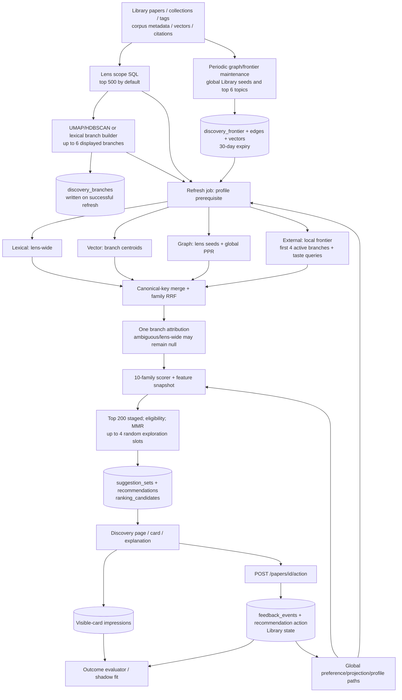

# Discovery: current system and ground-up plan

**As inspected:** working tree on `feature/discovery-lenses-branches`, 2026-09-24.
This is a code map, not a claim that the proposed architecture is implemented.
The [earlier audit](discovery-scope-and-learning-audit.md) contains historical
defects and read-only database evidence; some source defects in that ledger have
since been edited in this working tree and remain unverified. The
[design and method decisions](discovery-component-architecture.md) is the
authoritative target, revised after this map. Its decisions supersede the
initial target formerly appended to this map, particularly generic quality
scores, mandatory contrast pairs, single-centroid interests and learned
acquisition allocation.
The as-inspected source map and historical counts remain unchanged.

## What the product must decide

For each lens, Discovery should answer four separate questions: **where can we
find plausible papers not yet in the Library; which structural region does each
paper belong near; is this paper useful to this user in that region; which
qualified papers should we show now?** An action then answers a fifth question:
**what explicit evidence did the user give about that exposed paper, and at what
scope?** These questions need different data, metrics, and owners. A good
ranker cannot repair a missing acquisition pool; a Like cannot safely label
every author or term on its paper.

Feed owns monitored arrivals. Library owns saved membership, collections,
ratings and reading state. Authors owns canonical identity and follows.
Discovery owns lenses, structural branches, external acquisition plans,
candidate retrieval, context-specific scores, suggestions, exposure, and
branch-local learning. The shared corpus owns paper identity, metadata,
embeddings and citation edges. Dismiss is lens visibility only; Dislike is a
negative preference; Read is workflow. The corpus partition is structural and
does not move after a preference action (D6, D24, D26, D27).

## Actual data flow

The ordinary lens refresh performs **local reads**, not live source search.
Source acquisition is the separate scheduled/manual maintenance job. Four
retrieval lanes run concurrently on separate SQLite read connections with a
configurable 60-second deadline. The refresh then does CPU work, two bounded
writer-gated phases (candidate materialization, deck swap), and schedules
hydration/outcome evaluation. One timeout yields a thinner deck and a recorded
lane failure. The background frontier sequence is citation coupling, external
source queries/S2 recommendations, then vector filling, committing between
network phases. Periodic lens refresh is opt-in; graph/frontier maintenance
defaults to a 24-hour interval; scoring calibration defaults to 12 hours.

### Other Discovery entry points and duplicate logic

The lens refresh is the active recommendation pipeline, but the API exposes
other Discovery paths. They matter because they can bypass its scope and
measurement model:

| Entry point | Actual path | Relationship to the lens lifecycle |
|---|---|---|
| `POST /discovery/similar` | `routes/discovery.py` → `discovery/engine.py::discover_similar_with_meta`; OpenAlex related/citing and S2 per-paper recommendations, then a local dense fallback if network yields nothing; cached by selected seed IDs. | Used from Discovery and Library. It can fetch live external papers, but has no lens/branch context, deck snapshot or exposed branch-local outcome. Treat as a distinct similarity tool or route its leads into the shared acquisition/evidence contract. |
| `POST /discovery/manual-search` and `/manual-search/add` | Background `openalex_manual.search_online_sources` with cross-source query fusion; selected result is added to Library. | Explicit user search, not automatic branch discovery. Frontend API functions exist but no current frontend caller was found. Reuse canonical identity, metadata and action boundaries; do not quietly train a branch from an unscoped manual addition. |
| `GET /discovery/recommendations`, `/stats`, `/recommendations/{id}/explain`, `/{id}/seen`, and `DELETE /recommendations` | Generic recommendation read/management beside `/lenses/{id}/recommendations`. | Audit which consumer still needs the generic list/clear/seen semantics; the lens route is the Discovery page's deck read. One deck policy and one explanation source should serve both, avoiding divergent visibility or score rules. |
| `discovery/engine.py::generate_recommendations` and `refresh_recommendations` | Legacy global generator; the legacy refresh deletes neutral recommendations and writes through its own connection. No production caller under `src/alma` was found by reference search. | Candidate for removal after caller/compatibility review. It is a separate writer/scorer path and conflicts with the intended single orchestration owner. Confirm external/scripts references before deleting. |
| `GET/PUT /discovery/settings`, branch preview, frontier rebuild, calibration/outcome and channel-yield diagnostics | Settings write through one route; preview and diagnostic reads have their own cached/background jobs. | Maintain a control-to-effect registry. A slider should identify the stage it changes and show the measured result; a diagnostic fit must never silently become an online branch weight. |

The currently exposed API still declares a global channel-yield adaptation
setting, while lens refresh deliberately leaves its multiplier empty to avoid
cross-branch learning. That is a truthful-UI/unused-setting cleanup candidate.
Likewise, manual search, generic recommendations and similarity need an
explicit product decision: a separate tool may remain separate, but any
candidate or verdict later promoted into Discovery must pass through its
canonical identity, provenance and scope contracts.

### Stage ledger: owner, actual inputs, output, boundary

| Stage | Current code and durable state | What happens now | Missing contract or measurement |
|---|---|---|---|
| Lens and controls | `routes/lenses.py`, `lens_crud.py`; `discovery_lenses` | Global Library, collection, text keyword, or tag context; channel weights and branch controls live on lens row. | Distinguish structural membership from liked examples and candidate eligibility; revision each. |
| Seed selection | `seed_profile._load_seed_papers_for_lens` | Default 500, setting clamped 50–5,000. Global/collection order by rating then citations; keyword/tag by citations. Text keyword scans title/abstract and can include non-Library corpus papers. Zero seeds ends refresh. | Exact membership/count, long-tail coverage, intentional cold-start acquisition. A higher cap still changes the lens's meaning. |
| Structure | `seed_profile.resolve_lens_branches`, `branch_identity.py`, `discovery_branches` | Vector-capable seeds are clustered; lexical fallback; overflow/noise assigned; max six in refresh; IDs matched to persisted seed sets, then controls/outcome lifecycle applied. Preview uses a separate cached job. | Complete scope, embedding coverage and unassigned count; stable revisions and split/merge lineage; preview and refresh parity on the same revision. |
| Acquisition | `frontier.py`, `source_search.py`, scheduler; `discovery_frontier`, `_edges` | Up to six strongest global Library topic queries × 40 results, fixed six-year query horizon; up to 150 global S2 seeds, top six related papers, top four citing seeds; coupling default 1,500. Providers include OpenAlex, S2, Crossref, arXiv, bioRxiv, Europe PMC. Frontier entries expire at 30 days. | Per-branch query plan, source/page/seed provenance, coverage, exhaustion and budget. A branch query cannot find a paper absent from the prefetched frontier. Dismiss is still included in S2 negative seeds, violating D6. |
| Retrieval | `retrieval/{lexical,vector,graph,external}.py` | Lexical takes at most eight lens-wide query terms. Vector searches up to six resolved branch centroids. Graph traverses lens seed references/coupling/co-citation but PPR starts from global Library/Loved. External searches local frontier for first four active branches and lens/global taste variants. | Every active branch needs its own candidate allocation, graph/lexical context and per-lane recall. A bounded search budget should be explicit, not a hidden first-four branch cutoff. |
| Merge and identity | `retrieval/merge.py`, `branch_attribution.py` | Canonical-key dedup retains retrieval hits; family RRF then per-lens channel weights. A dominant branch may be assigned from hit evidence; overlap or no branch hit stays unattributed. | Canonical paper ID before selection, all candidate–branch contexts, attribution confidence, duplicate/identity-loss counts. |
| Features | `scoring_loop.py`, `features.py`; `discovery_ranking_candidates` | Candidate measurement, reward vs exposure features, availability flags, hit provenance, policy and schema versions are stored for staged candidates. | One versioned feature builder for retrieve/rank/reason/learn; stable author, venue, topic, phrase, method and embedding identities; no training on absent values. |
| Score | `ranker.py`, `discovery/scoring.py`, `signal_projection.py` | Ten related families plus a global profile/structured projection; missing families use a calibrated prior. Per-lens channel weights precede scoring. Shadow fit and signal tuning are diagnostic, not an active branch-local learner. | Separate branch relevance, paper quality and local taste; report incremental contribution and uncertainty; stop global learned effects crossing branches. |
| Selection | `__init__._refresh_lens_recommendations`, `exploration.py` | Full merged pool is scored, then top 200 staged. Library/action/reading/min-score exclusions follow. MMR applies author/topic/venue caps and reserves up to four uniformly sampled tail cards in the requested deck, normally 50. | Eligibility before staging; per-branch paginated streams plus overview; qualified reach, novelty and propensity by branch. The 50-card deck must not define discoverable breadth. |
| Persist and hydrate | `__init__._materialize_slate/_persist_refresh`; `papers`, `suggestion_sets`, `recommendations`, candidate snapshots | Selected papers are promoted to tracked corpus and hydration queued; unacted old recs are swapped for a new deck; actioned rows remain. Branch identities are persisted with the deck. | Pre-serialize ranking rows outside the writer gate; bounded batches; atomic version/revision check so a stale job cannot publish over newer lens state. |
| Exposure and action | `DiscoveryPage.tsx`, `useDiscoveryImpressions`, `routes/publications.py`, `paper_actions.py`; `discovery_impressions`, `feedback_events` | A visible card records an impression. Canonical action updates paper/lens state; Save/Like/Love/Dislike give preference; Dismiss only hides; Read queues. Recommendation/action and event linkage is still uneven. | Freeze displayed branch/context and aspect options; return event ID; one idempotent action trail; distinguish viewed, skipped, saved and explicitly disliked. |
| Learning and audit | `observations.py`, `feedback_substrate.py`, `outcome_eval.py`, `channel_yield.py` | Outcome loader requires a selected v3 snapshot, visible impression, linked later event and known propensity; randomized-only by default. Other profile/projection paths are global. | Branch-local fit from attributable exposed events; honest negative construction, chronological replay, component ablations, and unsupported-value neutral fallback. |

### The measures and their actual role

| Measure | Produced from | Used for / limitation |
|---|---|
| Seed count, rating, citations, topics, embedding availability | Lens SQL + corpus | Branch inputs and priors. Rating/citation ordering truncates scope at 500; membership is not a preference label. |
| Cluster membership, centroid, core/explore topics, branch score, outcome share | Seed vectors/text and 60-day branch action aggregation | Preview, vector search, frontier query strings and automatic controls. Structure and preference-driven allocation are partly mixed; small outcome samples can auto-mute. |
| Source/query/graph hits, rank, RRF, channel weights | Four retrieval lanes | Candidate inclusion and fused retrieval score. Multiple hits may be correlated; a hit is evidence of reach/relevance, not user taste. |
| Semantic/lexical similarity, topic, author, venue, recency, citation, feedback, preference | Candidate scorer and profile | Ten-family score. The current global learned profile is not branch-independent. Exact-value availability does not imply a learned coefficient. |
| Prior score, shadow score, reward/exposure features, propensity | Candidate snapshot and slate policy | Explanation and retrospective evaluation. Only recorded, exposed decisions can supply a causal outcome. |
| Impression, action, optional reason | Visible card and canonical action | Presently only impression + action exists. A paper verdict alone confounds all its authors/topics/phrases; optional aspect selection is proposed. |
| Qualified unseen yield, coverage, latency, source cost | **Not consistently recorded end-to-end** | These are required measures for deciding whether Discovery actually finds valuable external papers. |

The default score weights are retrieval **0.14**, semantic/lexical together
**0.51** (87% semantic), citation **0.12**, feedback **0.09**,
preference **0.09**, venue **0.05**, and topic/author/recency **0**.
The weights were fitted to separate historical Library papers from rejected
and random corpus papers, not to predict future branch-specific usefulness.
The `recommendation_mode` changes some family weights, while branch temperature
changes query composition and a few discrete choices (including nearest vs
farthest cluster at 0.5). Neither controls the slate's fixed four exploration
slots. Thus neither knob currently means a measured discovery distance or
exploration share. Per-lens channel weights, global score-family weights,
retrieval RRF, bounded citation bonuses and diversity selection all affect a
paper at different stages; their individual effects need separate ablations.

## Concrete failure chain

Suppose a user makes a methods lens from a large collection and wants a novel
paper at its edge. The first 500 highly rated/cited papers define branches;
the method in paper 501 may not participate. The maintenance job searches six
global Library topics, which may never include that method. The refresh's
branch query only searches the already built frontier. Lexical and graph lanes
search lens-wide; vector can retrieve a local semantic neighbour of an included
branch; external searches only four branches. Even if the desired paper is in
the merged pool, scoring and top-200 staging can discard it before eligibility
and branch coverage are considered. The user sees at most 50 cards. A later
Like influences global projection/profile paths and does not by itself tell us
which of that paper's exact values the user liked. This is why tuning weights
alone cannot solve the discovery objective.

The measured copies reinforce the limit: production had 4,175 papers, one
lens and 50 recommendations, only four with branch IDs; dev had 12,148 papers,
two lenses and 264 recommendations, only ten with branch IDs. Neither copy
contains an exposed positive/negative pair in one branch. The dev copy has
5,289 candidate snapshots, but those are mainly feature coverage, not
branch-learning labels. See the [evidence audit](discovery-scope-and-learning-audit.md)
for exact counts and caveats. No claim of branch-local model accuracy follows
from these data.

## Design and execution ownership

The target model and implementation sequence are maintained in
[Discovery design and method decisions](discovery-component-architecture.md).
That specification supersedes the initial target previously appended to this
code map. It defines reference scope versus candidate eligibility, multi-aspect
representations, structural acquisition, exact local learning, ordinal/aspect
supervision, slate policy, uncertainty, evaluation and runtime contracts.

The consolidated local task 92 owns gates G0–G6 and their completion evidence.
The [compute audit](discovery-compute-and-pi-audit.md) tracks proposed and active
paths for deferred task 94. Keeping this page focused on observed code prevents
an intended algorithm from being mistaken for an implemented capability.
