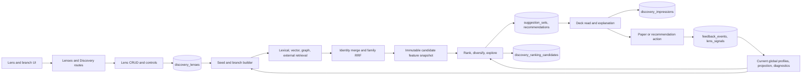

# Discovery scope and learning audit

This is the **2026-09-23 audit baseline** for the combined Discovery workstream.
The [2026-09-24 as-inspected map](discovery-current-state-map.md) supersedes
its source-state claims where this working branch has since been edited. In
particular, durable `discovery_branches`, shared branch resolution, branch-aware
vector retrieval, disabled global channel-yield application, and revised UI
error/freshness behavior are now present as unverified working-tree changes;
the defect ledger below retains their original findings until implementation
is reviewed and verified; the [reconciled ledger](#reconciled-ledger-2026-10-30)
gives each one's status against source. Measurements use private
read-only SQLite backups taken on 2026-09-23: production (4,175 papers) and
the isolated dev profile (12,148 papers). Neither backup is part of Git.

## Product boundary

Discovery owns lenses, branches, candidate retrieval, ranking, recommendation
decks, explanation, exposure, and learning from explicitly attributable user
actions. Feed owns deterministic source monitoring; Library owns membership and
organisation; Authors owns identity and follows. Discovery may read those
surfaces through their contracts, but its learned taste must belong to the
specific branch that produced and exposed a suggestion (D26). A new branch
starts from shipped defaults. A lens names a context; it is not a hidden pool of
learned taste shared by its branches.

Preference, visibility, and membership are separate (D6). Dismiss hides a
suggestion and is not negative evidence. Dislike is an explicit negative
verdict. An unseen or merely unacted-on paper is not a negative. The semantic
partition and branch membership are corpus structure; taste may change query
allocation and ordering within a branch, never rewrite that structure. Map
and Signal Lab additive heads remain outside core (D24/D25); learning itself
belongs to Discovery core (D27).

## Current lifecycle and owners

| Transition | Current owner and durable fields | Audit finding |
|---|---|---|
| Create, edit, delete, order lens | `api/routes/lenses.py` → `application/discovery/lens_crud.py`; `discovery_lenses` stores context, channel weights, controls, profile and freshness | A lens is a container and seed context, but global taste is also read during refresh. |
| Resolve seeds and branches | `seed_profile.py` (`_load_seed_papers_for_lens`, `_build_seed_branches`); `_make_branch_id` in `lens_crud.py` | Branches have no durable row. Their ID embeds mutable topic slug and seed-set hash; controls live in lens JSON. |
| Preview | `seed_profile.preview_lens_branches` and `branch_preview.py` | Applies outcome enrichment and automatic lifecycle; cache omits seed and feedback revisions. |
| Refresh | `application/discovery/__init__.py`; retrieval in `retrieval/{lexical,vector,graph,external,merge}.py` | External lane applies manual controls without preview's automatic lifecycle or `auto_weight`; branch queries, global taste queries, and lens-wide lanes coexist. |
| Fusion and candidate features | `retrieval/merge.py`, `features.py`, `scoring_loop.py`; `discovery_ranking_candidates` records reward, exposure, retrieval hits, policy and model versions | Full hits survive in snapshots, while displayed/stored recommendation has only one branch ID even when several contributed. |
| Rank and persist | `ranker.py`, `scoring_loop.py`, `application/discovery/__init__.py`; `suggestion_sets` and `recommendations` | Family weights and channel-yield multipliers are global; one branch's behavior can move another branch's deck. |
| Read and explain | `api/routes/discovery.py`, `api/routes/lenses.py`, `DiscoveryPage.tsx`, `PaperDetailPanel.tsx` | The page can show a global refresh time under a selected lens; fetch failure looks like an empty deck; explanation failure is cached as `null`. |
| Exposure | `discovery_impressions`; frontend `useDiscoveryImpressions.ts` | Exposure is recorded, but historical branch-attributed recommendation rows have no matching impressions in the measured copies. |
| Action | `lens_crud.mark_recommendation_action` → `library.record_paper_feedback` → `feedback_substrate.record_feedback`; `recommendations.user_action`, `feedback_events`, `lens_signals` | Like/love/dislike do not stamp recommendation rows; Dismiss does. The branch outcome aggregator reads those rows and therefore sees the wrong verdicts. |
| Learn | `feedback_substrate.py`, `signal_projection.py`, `discovery/scoring.py`, `channel_yield.py`, `outcome_eval.py` | Global preference profiles and projections are mixed into branch refresh. `paper_action` produces zero affinity delta in one path; a separate projection path learns signed values globally. The family-weight fitter is diagnostic and global. |

The [pipeline reference](discovery-pipeline.md) describes retrieval fusion and
immutable snapshots. This table records the audit baseline; consult the
[as-inspected map](discovery-current-state-map.md) for current working-tree
ownership and the complete lifecycle.

## Evidence volume and granularity

| Measured item | Production copy | Dev copy | Consequence |
|---|---:|---:|---|
| Lenses / recommendations | 1 / 50 | 2 / 264 | Very few independent contexts. |
| Recommendations with branch ID | 4 | 10 | Most deck outcomes cannot be attributed to a branch. |
| Branch-ID rows with explicit positive/negative preference | 0 | 4 saved, 0 dislike | Insufficient to fit branch-local coefficients or entity effects. |
| Branch-ID rows with recorded item impression | no impression table | 0 | Cannot construct an honest exposed contrastive pair from those rows. |
| Feedback events linked to a recommendation ID | 0 | 0 | Existing historical events cannot be assigned to a branch through their event context. Current code now writes that key; historical data do not. |
| Immutable candidate snapshots / selected | absent | 5,289 / 1,700 | Useful for replay and feature coverage, not labels for unseen candidates. |
| Actual item impressions | absent | 211 | Exposure exists in dev, but does not cover the branch-attributed rows. |

Dev candidate snapshots show that individual signal **availability differs
from learned influence**. All 5,289 snapshots have a numeric `projection_author_raw`,
`projection_keyword_raw`, and `projection_tag_raw` field, but all three are
zero. `projection_author_name_raw` varies in 4,035, `projection_topic_raw` in
3,495, `projection_venue_raw` in 4,674, and
`projection_semantic_neighbor_raw` in 2,527. The negative semantic signal is
zero in all 5,289 snapshots despite 40 negatively rated dev papers having
embeddings. Paper keyword metadata is present in 2,811 of 5,075 candidate
rows joined to corpus papers, so a zero keyword projection cannot be explained
as absence of all keyword metadata. Candidate `author_id` is absent in all
5,075 joined rows while 5,069 have author-name metadata; entity ID and name
paths must be audited separately. These are coverage observations, not claims
that the nonzero signals improve ranking.

No honest per-branch or per-entity model can be validated against this tiny,
historically unlinked label set. The first implementation gate is trustworthy
branch identity, provenance, exposure and action linkage; then planted-signal
tests and forward-collected within-branch comparisons can judge fine-grained
effects. Absence of evidence keeps that branch at shipped defaults, rather
than borrowing another branch's preferences.

## Value-level learning contract to establish

### Controls, score and exploration: additional current-state findings

| Control or stage | What current code actually does | Design consequence |
|---|---|---|
| `lens.max_seeds` (500 default; clamped 50–5,000) | `_load_seed_papers_for_lens` truncates global/collection membership by rating then citations, and topic/tag membership by citations. | This changes lens structure and retrieval context, and excludes the long tail. Remove the fixed count; represent every eligible member. Done 2026-10-30, see below. |
| Branch temperature | `_resolve_branch_temperature` prefers per-lens override, then global `branches.temperature`, then a mode-based fallback. Since the global default exists, the rank mode usually does not determine temperature. `_build_seed_branches` changes core/explore topic counts and jumps from nearest to farthest cluster at 0.5; query planning also switches a word at 0.4. | It is neither a smooth semantic-distance control nor a deck exploration share. Replace with a measurable reach policy and keep structural resolution independent. |
| Rank `recommendation_mode` | `explore` and `exploit` multiply family weights before normalization; default author and recency are zero, so multipliers on them do nothing. The mode does not change the selector's fixed four random exploration slots. | Remove or unify with the reach policy after measuring impact; do not advertise it as actual exploratory coverage. |
| Branch count and coverage | Branch display defaults to six; external retrieval processes only the first four active branches. Lexical and graph lanes use lens-wide seeds, and graph PPR uses global Library/Loved seeds. | Every active branch needs a nonzero candidate budget and its own browsable, paginated stream. Avoid a shared 50-card ceiling and hidden first-four cutoff. |
| Candidate/deck limits | Each of four retrieval lanes receives the refresh `limit` (50 by default); after full scoring the workflow stages only the top 200 and builds a deck of at most the requested limit. `build_slate` cannot recover a branch absent from that scored top 200. | Replace one global cut with bounded per-branch pools, paginated result persistence and transparent coverage metrics. Bound work and writes per chunk, rather than excluding long-tail branches. |
| Automatic branch lifecycle | Smoothed positive share (six pseudo-observations, 60-day window, 30-day decay) yields 0.3–1.8 allocation weight; at ≤0.65 core/explore topics swap and at ≤0.55 the branch auto-mutes. Cold branches get 1.15. | Selected, sparse outcomes should not erase structural coverage. Retire automatic mute/rotation; constrain adaptation above an explicit exploration floor. |
| Slate exploration | `build_slate` reserves up to four uniform tail picks; MMR/caps fill the rest. This is independent of temperature and branch targets. | Allocate quality-qualified core/adjacent/bridge/far opportunities per branch, then interleave an overview and record realized novelty/distance. |
| Branch preview UI | The local temperature slider is passed on save, but `useBranchPreview` passes only resolution to the preview call. | An unsaved temperature change does not produce a truthful preview. Preview must use the same proposed controls and plan as the next refresh. |
| Rank and learning | Ten families score globally through one profile; `fit_shadow_ranker` runs during refresh but is diagnostic; `signal_tuning` is in-sample diagnostic. Exact value keys are stored provisionally but have no branch-local score effect. | First isolate and simplify relevance, quality, local taste and slate selection; fit only supported local effects, then verify on future exposed comparisons. |

The current `DEFAULT_SIGNAL_WEIGHTS` were fitted on 539 Library papers against
rejected and random corpus papers. That holdout measures a retrospective
Library/corpus separation task, not Discovery's prospective, branch-local
user utility. The source notes that three families were not measurable in the
offline fit. Report this as a shipped prior, not evidence that each family
improves the Discovery deck. Retrieval and slate diversity require separate
evaluation from the ranker's within-pool ordering.

### Acquisition is the primary recall bottleneck

The ordinary lens refresh makes no live source search. Its four local lanes
search the corpus and the 30-day offline `discovery_frontier`; network source
collection occurs in `run_frontier_maintenance`. `build_discovery_frontier`
searches only the six strongest **global Library topics**, 40 results per query,
with a six-year recency bound and a fixed `temperature=0.28`. It also requests
one global Semantic Scholar recommendation set, all-time neighbours for at
most six globally selected papers, and citing works for four top-rated OpenAlex
papers. Bibliographic-coupling backfill is another bounded global path. The
frontier has no lens/branch-specific acquisition plan or coverage ledger.
Branch query variants in refresh search only that already-populated frontier;
they cannot fetch a missing paper. Therefore even perfect branch ranking cannot
recover a relevant unseen paper absent from both corpus and frontier.

`_s2_seed_identifiers` selects up to 150 globally rated/status papers and
currently puts `status='dismissed'` in the Semantic Scholar **negative** seed
list. This conflicts with D6's visibility-only Dismiss meaning. The source
query's global top-topic policy also violates D26's branch-independent taste
once its candidates are presented as branch-driven Discovery. Both need a
canonical branch-local acquisition planner and action semantics repair.

The 50/200 limits are not the only selection boundaries. `source_search` caps
each provider at 25 per query, discards responses after a 20-second frontier
query deadline, and the frontier expires after 30 days. These are valid resource
controls only if the system records each branch's query coverage, source
failure, exhaustion/pagination and age distribution; otherwise a thin deck is
ambiguous between weak relevance and absent acquisition.

The current filter removes Library, globally dismissed/removed, and reading
queue papers for ordinary lenses; collection lenses have different membership
rules. A tracked corpus paper can be a Discovery candidate even if already
surfaced elsewhere. The product should distinguish **new to Library**, **new
to Discovery**, and **not previously seen anywhere** using durable exposure
provenance. These are different novelty claims, and neither should be inferred
from `status` alone.

### Proposed evidence and decision model

At acquisition, preserve provider/query/seed/rank, result page, time and
failure. At rank time, keep these concepts separate:

1. **Eligibility and safety:** canonical identity, lens membership/exclusion,
   retraction and other hard facts. Missing dates and metadata are unknown,
   not negative evidence.
2. **Branch relevance:** semantic, lexical, citation and entity relations to
   that branch's *complete* structural membership; calibrate and fuse correlated
   views without paying the same fact twice.
3. **Paper quality:** intrinsic evidence such as field/year-normalized citation
   impact, study type and metadata confidence. Avoid raw citation popularity as
   a universal relevance proxy or a blanket penalty on recent work.
4. **Branch taste:** signed, regularized effects for exact values and compatible
   semantic directions learned only from that branch's impressed explicit
   outcomes. The branch's corpus shape is context, not learned preference.
5. **Slate utility:** novelty, coverage of branch facets, source/author/venue
   diversity and exploration distance. Apply after candidate scoring and record
   realized opportunity and inclusion probabilities.

Use a single candidate × branch feature record; family fusion is a retrieval
signal, not another taste reward. One rank formula must expose each calibrated
contribution, availability, support, uncertainty and version. Learn a weight
only when a source of independent variation identifies its incremental effect.
Interactions such as author × topic or method × population require stronger
support than single-value effects; otherwise shrink them to zero. A candidate
found by multiple branches can have several scores and one selected displayed
context, with the alternatives retained as provenance.
Because one paper bundles many authors, topics, phrases and methods, a bare
Like/Dislike rarely identifies which tiny value caused the judgment. Matched
visible contrasts reduce this confounding; an optional reason attached to an
explicit verdict on the card could identify a value directly. It must use the
canonical branch action path and must never reinterpret Dismiss as a Dislike.

The current ten-family score has several interactions to resolve before
reweighting: semantic similarity and the semantic retrieval rank are related;
lexical overlap and lexical retrieval rank are related; citation count, graph
proximity and citation retrieval share a family or pipeline; author/venue/topic
affinities overlap with the feedback/preference projections. The ranker groups
some atoms with `max` or `noisy_or` and imputes missing families to a corpus
prior, which avoids simple missing-data punishment but does not establish that
these families are independent or branch-scoped. Default topic, author and
recency family weights are zero; venue remains 0.05, citation 0.12, retrieval
0.14, feedback 0.09, preference 0.09, and text similarity 0.51 split 87%/13%
between semantic/lexical. Thus the nominally broad control surface mostly
reorders by semantic proximity and overlapping global taste. The previous
offline AUC fit cannot settle whether that combination finds *unseen useful*
papers; compare source, feature and family ablations on acquisition and
exposed outcomes separately.

### Manifold hypothesis, without a second map product

The useful object is a sparse high-dimensional neighbourhood graph over
papers, with semantic similarity and separately typed citation edges. It can
support local neighbourhood retrieval, boundary/bridge discovery, branch
cohesion checks and uncertainty-aware exploration. A branch is a stable region
on this graph; its taste can be modelled as a **local signed field** over exact
features and nearby semantic directions. Smoothing must stay inside that
branch and decay with graph distance and evidence uncertainty. It must not
change paper coordinates or structural membership, and it must not spread a
verdict into another branch (D26).

Do not rank by distance in a 2-D UMAP layout. [UMAP](https://arxiv.org/abs/1802.03426)
reduces high-dimensional neighbourhoods; its coordinates are useful for
visualisation/partition diagnostics, but the source semantic
distance, sparse graph relationships and calibrated local evidence should be
the ranking inputs. A [diffusion-map](https://www.math.ucdavis.edu/~strohmer/courses/270/diffusion_maps.pdf)
or manifold-distance candidate generator
is a challenger against direct kNN, citation traversal and simple branch
centroids. Adopt it only if it finds additional relevant unseen papers at an
acceptable CPU/RAM cost and with stable branch boundaries. The Map UI remains
outside Discovery core (D24).

SPECTER2 already uses [citation-derived triplet contrast](https://github.com/allenai/SPECTER2)
in its upstream model
training. ALMa currently uses its representations for structure/similarity;
that training does not constitute personal contrastive taste learning. The
branch-local fitter has not been wired. ICA is absent from the Discovery path.
It may expose [interpretable independent axes](https://aclanthology.org/2023.emnlp-main.283/)
from text or embeddings, but it
does not label user preference. Compare it offline to sparse text factors,
cluster descriptors and a direct within-branch positive-minus-negative vector;
adopt only if axes remain stable and improve held-out exposed ranking beyond
the simpler model. Lack of valid branch pairs currently prevents an accuracy
claim for any of these alternatives.

| Dimension | Present signal | Required branch-local contrast |
|---|---|---|
| Author | Names, follows, coauthor graph, global affinity/projection; stable `author_id` absent in sampled candidate rows | Exact identified author where possible; name only with identity confidence. Compare explicitly liked and disliked **exposed** papers in the same branch, accounting for topic and coauthor spillover. |
| Venue | Journal affinity and global exact-venue projection | Compare venue while holding topic/period roughly fixed; shrink sparse venues to neutral. |
| Topic | Topic overlap and global term projection | Distinguish exact topic from broad branch seed membership; update only when explicit within-branch evidence separates it. |
| Keyword or phrase | Candidate metadata exists, but sampled keyword projection is identically zero | Preserve normalised phrase identity in snapshots; compare it against matched alternatives within one branch, avoiding token-level false matches. |
| Semantic direction or cluster | Vector similarity, exemplars, global signed neighbor projection; sampled negative semantic signal zero | Contrast exposed positive and explicit negative embeddings within one branch. Keep exploration; never change corpus partition membership from taste. |
| Method, population, domain, type | Some text/keyword/work-type metadata, no separate estimator evidenced in current map | First define observable, reproducible feature extraction and coverage; fit only identifiable values with independent outcomes. |
| Recency and citations | Available numeric families and global weight fitting | Conditional within-branch comparisons; do not infer preference from a top-ranked, unexposed sample. |

One canonical, versioned value snapshot should feed fit, rank, stored replay and
explanation. Every learned change needs explicit provenance, support,
uncertainty, cold-start shrinkage and a branch reset. Retrieval breadth and
ranking quality need separate measurements: re-ranking cannot recover a paper
that no retrieval lane found. A metric/contrastive embedding model is a
challenger only after simpler per-value and pairwise estimators are tested on
identifiable evidence.

## Defect ledger (open at audit start)

| ID | Severity | Evidence / owner | Violated contract |
|---|---|---|---|
| D92-01 | P0 | `channel_yield.py` pools outcome evidence globally; `application/discovery/__init__.py` applies it to every lens. `ranker.resolve_family_weights` and `discovery/scoring.py` also read global learned taste. | D26 branch isolation. |
| D92-02 | P0 | `lens_crud.mark_recommendation_action` does not stamp like/love/dislike on recommendations; `_aggregate_branch_outcomes` reads those stamps and treats Dismiss as negative. | D6 and truthful branch learning. |
| D92-03 | P0 | `feedback_substrate._affinity_delta` has no `paper_action` case; canonical paper actions increase profile counts with zero delta. | Counts must represent real tuning evidence. |
| D92-04 | P0 | `retrieval/external.py` and `retrieval/merge.py` collapse several branch hits to one stored `branch_id`; current historical data have little branch attribution. | Causal attribution and honest explanation. |
| D92-05 | P1 | `seed_profile.preview_lens_branches` applies automatic outcome/lifecycle changes that external refresh does not; its cache key omits seed and action revisions. | Preview/refresh parity and freshness. |
| D92-06 | P1 | `_make_branch_id` includes mutable slug; `_load_branch_seed_history` calls recommendation outputs historical seeds. | Durable branch identity and control lineage. |
| D92-07 | P2 | Legacy Insights branch-action route resolves lenses via past recommendations, so it cannot control a new previewed branch. The active Branch Explorer instead writes `lens.branch_controls` through `PUT /lenses/{id}`; audit whether the duplicate route should be removed. | One owner for branch controls and no dead route. |
| D92-08 | P1 | `DiscoveryPage.tsx` reapplies `?lens=` whenever selected lens changes, so a deep link can trap lens selection. Recommendation errors appear as empty decks; explanation errors cannot retry; selected lens uses global freshness. | Navigation and truthful status. |
| D92-09 | P2 | `DiscoveryPage.tsx` offers selection/Select All with no bulk consumer and fabricates January 1 for year-only recent sorting. | Useful controls and truthful dates. |
| D92-10 | P0 | `retrieval/vector.py` builds a second cluster system with positional IDs (`vector_branch_0`, etc.), independent of the lens branches produced by `seed_profile.py`; other local lanes are lens-wide. | Every ranking candidate needs a stable branch context, not an unrelated query index or first-hit branch. |
| D92-11 | P0 | `frontier.build_discovery_frontier` queries only six strongest global Library topics and globally selected S2/OpenAlex seed papers; refresh branch queries search this prefetched pool only. | A branch cannot discover unseen external papers outside a narrow global frontier; acquisition recall must be branch-local and measured before ranking. |
| D92-12 | P0 | `frontier._s2_seed_identifiers` includes `status='dismissed'` as an S2 negative seed. | D6 says Dismiss is visibility-only; it cannot train an external recommendation request as negative taste. |

Fixes should be checked at the primitive that owns each contract. Each ledger
entry needs reproduction, regression guard and live recheck before closure.

## Reconciled ledger (2026-10-30)

Checked against `feature/discovery-g0` source on 2026-10-30, not against the
table above, which stays as the audit record. Live means the isolated `g0`
instance, a private copy of the dev database, driven through the HTTP API.
Prod means read-only SQLite against the running container. "Owner" is the file
that holds the contract, then the Task 92 gate that closes any remainder.
Test file: `tests/test_discovery_g0_semantics.py` in the local test repository.

**Status counts.** Original twelve: 7 fixed, 2 superseded, 3 open. Found during
reconciliation: 8 fixed, 7 open.

### Original entries

| ID | Status | Current source | Proof and what remains |
|---|---|---|---|
| D92-01 | open, narrowed | `application/discovery/__init__.py:368`, `discovery/scoring.py:471`, `discovery/scoring.py:926`, `application/discovery/ranker.py:626` | Channel yield no longer reaches a lens: `yield_multipliers` is an empty dict and stays diagnostic. Global taste and global family weights still feed every branch. Owner: `ranker.py`, G3. |
| D92-02 | fixed | `application/discovery/lens_crud.py:1110` | Verdicts come from linked events; Dismiss adds to no preference bucket. `test_dismiss_on_a_saved_paper_changes_no_branch_outcome`. Live: Dismiss wrote 0 events and engagement stayed 0. Prod copies predate linkage: 33 of 336 action events carry a recommendation id. |
| D92-03 | fixed | `services/feedback_substrate.py:175` | A zero delta no longer raises `interaction_count` or `confidence`, on the paper or its topics and authors. `paper_action` keeps no delta on purpose, because a global profile would break D26. `test_zero_valued_action_is_not_tuning_evidence`. |
| D92-04 | superseded | `application/discovery/branch_attribution.py:33`, `application/discovery/__init__.py:699` | Attribution reads all hits, ties stay unattributed, and hits survive in the snapshot. Keeping several candidate-branch contexts is G3 design. Live deck: 16 of 50 cards carried a branch. |
| D92-05 | open, narrowed | `application/discovery/seed_profile.py:1510`, `application/discovery/branch_preview.py:26` | Preview and refresh share `resolve_lens_branches`. The preview key still omits seed and action revisions, so a Save can leave a preview stale until the next refresh changes the set id. Owner: `branch_preview.py`, G2. |
| D92-06 | fixed | `application/discovery/branch_identity.py:29`, `application/discovery/lens_crud.py:1777` | `_load_branch_seed_history` is gone. A mutable-slug id is only a birth name; seed overlap in `discovery_branches` carries identity. Rebuild lineage is `successor_ids` (D92-29). Test: `test_discovery_branch_identity.py`. |
| D92-07 | fixed | `application/discovery/lens_crud.py:943`, `api/routes/insights.py:2648` | The route now finds a lens through the identity table, so a new branch can be controlled. No frontend caller remains; deleting the route is a product decision. Live on 2026-10-30, sprint item C0. |
| D92-08 | fixed | `frontend/src/pages/DiscoveryPage.tsx:253`, `frontend/src/pages/DiscoveryPage.tsx:1382`, `frontend/src/pages/DiscoveryPage.tsx:1081` | Deep link applies once per route, errors show Retry, refresh time belongs to the lens. Browser pass recorded in sprint item A1. |
| D92-09 | fixed | `frontend/src/pages/DiscoveryPage.tsx:688` | Year-only dates stay year-only. The selection controls are gone: no bulk state remains in the page. |
| D92-10 | superseded | `application/discovery/retrieval/vector.py:213` | The refresh passes resolved branches. Positional ids survive only for direct lane callers. Lexical and graph lanes are still lens-wide, which belongs to G3. |
| D92-11 | open | `application/discovery/frontier.py:301`, `application/discovery/frontier.py:330` | Queries still come from the strongest global Library topics at a fixed temperature. Owner: `frontier.py`, G2. |
| D92-12 | fixed | `application/discovery/frontier.py:913` | `status='dismissed'` left the predicate. `test_dismissed_paper_is_not_an_s2_negative_seed`. History is not yet clean: see D92-13. |

### Found during reconciliation

| ID | Status | Source | Reproduction and guard |
|---|---|---|---|
| D92-13 | fixed, migrator not released | `core/migrations.py` (`_m_0047_clear_legacy_dismiss_ratings`) | Dismiss wrote `rating=1` until July. Schema 47 sets it back to 0 only on a dismissed paper, never in the Library, whose events are legacy Dismiss alone, with no other recommendation, Feed or positive lens action. Any doubt keeps the rating. Preview: dev 21 cleared, 12 kept; prod 17 cleared, 18 kept. One prod paper in the Library holds a stale 1 and stays for a user decision. Live on a dev copy: 21 ratings moved, no other paper field, event or lens signal did. `test_dismiss_then_a_real_dislike_keeps_its_rating`, `test_a_second_run_changes_nothing`. |
| D92-14 | fixed | `application/discovery/observations.py:247` | Text comparison of a space against `T` dropped every reaction on the day of its impression. `test_an_action_on_the_day_it_was_seen_is_an_observation`, red then green. Live: 2 observations from Like and Dislike. |
| D92-15 | fixed | `application/discovery/observations.py:275` | A legacy Dismiss payload (`signal_value=-1`) became a negative label, masked by D92-14 until that was fixed. `test_legacy_dismiss_event_is_not_a_negative_label`. Dev holds 52 such events and prod 80. |
| D92-16 | fixed | `application/discovery/observations.py:154`, `application/recommendation_outcomes.py:225` | A snapshot scored under a paper later merged lost its link and failed the impression batch. Linked by set and position; 102 of 102 recent dev rows agree. `test_merged_paper_keeps_its_snapshot_impression_and_label`. |
| D92-17 | fixed | `application/signal_projection.py:153` | Three Likes summed to 1.5 against 0.5, and a later Dislike could not overturn them. The newest verdict now stands. `test_repeated_like_is_one_effective_signal`, `test_changed_mind_is_the_latest_verdict_not_their_sum`. |
| D92-18 | fixed | `application/discovery/lens_crud.py:1133` | One paper judged in two decks counted twice in a branch. `test_one_paper_liked_in_two_decks_is_one_branch_outcome`. |
| D92-19 | fixed | `application/library.py:1234` | Leaving the Library cleared another lens's Dismiss, and undone Likes kept their lens signal. `test_undoing_a_save_keeps_another_lens_dismiss`, `test_undone_like_leaves_no_lens_signal`. |
| D92-20 | open, cause known | `application/discovery/frontier.py:839`, `core/network_policy.py:59`, `api/scheduler.py:2433` | Dev's external lane returned 0 because its 427 leads expired on 2026-08-26 and the clock-started rebuild is off outside prod. Reviving them on a copy gave 50 candidates and 24 lane runs. Prod is healthy: 11,792 live leads, 50 candidates. Fixed part: `frontier_size` is stored and the chip says so. A dev rebuild needs the user's click or `ALMA_UNATTENDED_NETWORK=1`. |
| D92-21 | fixed | `application/signal_projection.py` (`load_paper_verdicts`), `application/paper_signal.py` | The Library signal score and `compute_paper_signal_map` read one helper: one verdict per paper, newest wins. `_FEEDBACK_SATURATION` moved from 5 to 1, so a fresh Love reads 1.0, Like 0.75, Dislike 0.25, where 5 would have held every paper to 0.4 to 0.6. Dev: top 50 of 141 Library papers 49 of 50, largest score change 0.031, no paper crossed a seed threshold, no lens prior moved. `test_repeated_like_is_one_verdict_in_the_library_score`. |
| D92-22 | open | `application/discovery/lens_crud.py:478` | Like on a Loved paper lowers its rating from 5 to 4 in Discovery, while `apply_valence` keeps 5 elsewhere. |
| D92-23 | open | `application/alerts.py:513`, `application/discovery/lens_crud.py:675`, `services/feedback_substrate.py:957` | These counters read `user_action='like'`, which no path stamps, so `liked` is always 0. |
| D92-24 | open | `application/discovery/__init__.py:1713` | A refresh deletes Like and Dislike rows, so `build_recommendation_outcomes` and every report on it lose those cards. Events survive, and branch outcomes already read them. |
| D92-25 | open | `application/discovery/observations.py:169` | One deleted or unlinked recommendation fails a whole impression batch, and the page swallows the error. |
| D92-26 | open | [Public controls](discovery-current-state-map.md#public-controls) | Seven `strategies.*` keys and two `limits.feedback_decay_*` keys change nothing in a lens refresh, yet Settings offers the strategies. G4. |
| D92-27 | open, limit | `application/discovery/features.py:27` | Exact replay holds for the current ranker only; see below. |

### Snapshot replay, measured 2026-10-30

Each row re-scored from its stored features, stored weights and stored
calibration, compared with its stored `prior_score`, tolerance 1e-6.

| Feature schema / ranker | Dev rows | Exact | Prod rows | Exact |
|---|---:|---:|---:|---:|
| v6 / v8 | 288 | 288 | 1,068 | 1,068 |
| v7 / v8 | 288 | 288 | absent | absent |
| v5 / v7 | 2,289 | 64 | absent | absent |
| v5 / v6 | 142 | 0 | absent | absent |
| v5 and v4 / v5 | 852 | 0 | absent | absent |
| v3 / v3 and v4 | 2,006 | no stored weights | 1,169 | no stored weights |

Replay is exact for every row the current ranker wrote. Older rows keep their
features, but today's code does not reproduce their scores, and rows before v4
stored no weights. The cause of the older mismatches was not traced. Guard:
`test_a_stored_snapshot_replays_its_exact_score`.

### Unexplained

Refresh `lens_refresh_5b20796b10` took 414 s, with scoring at 235 s against about
0.5 s normally. Its window overlapped `papers.rehydrate_metadata` and
`authors.rehydrate_metadata`. Three later refreshes on a fresh `g0` server took
51 to 57 s with scoring 360 to 528 ms, one of them under 1,742 concurrent write
commits. This is not reproduced and not fixed; the overlap is a correlation only.

The frozen baseline and judged-pool rules are in the
[baseline and relevance protocol](discovery-baseline-and-relevance-protocol.md).

## Every Library paper counts (2026-10-30)

User rule: no low caps, and never always the same subset, because part of the
Library then stays silent. The local path has no cap. A true limit, an external
API's or a network budget, keeps the strongest half and walks the rest over
successive runs (`core/rotation.py`). A window is a pure function of the ranked
pool, the budget and the cursor; the job result records pool and cursors, and a
source that failed keeps its window. The ring is ordered by a hash of each item,
so a new paper never makes it skip another.

Shares are read-only from prod (547 Library papers, 538 embedded) and dev (141,
139). "Always" means the same papers on every run.

| Site | Was | Silent on prod | Silent on dev | Rating | Now |
|---|---|---:|---:|---|---|
| `seed_profile._load_seed_papers_for_lens` | 500, clamp 50 to 5,000, rating then citations | 47, always | 0 | Silent forever | No cap, for all four lens types |
| Branch clustering, seed with no vector | Left out of every branch | 9, until embedded | 2 | Silent in branches | Joins the branch sharing most terms |
| `similarity.load_publication_example_embeddings` | First 400 vectors, newest added | 137 of 537, always | 0 | Silent as exemplars; still in the centroid | Every vector |
| `frontier._s2_seed_identifiers`, positives | Rating 4+ only, 150 shared with negatives, 100 per list | 460 of 540, always | 105 of 140 | Silent forever | Every saved paper, rotating 100 per list |
| `frontier`, per-paper S2 neighbours | `positive[:6]` | 534 of 540, always | 134 of 140 | Silent forever | Rotating 6 |
| `frontier._positive_openalex_seed_ids` | 4 newest of rating 4+ | 221 of 225, always | 80 of 84 | Silent forever | Rotating 4 of all saved |
| `frontier.build_discovery_frontier`, topic queries | 6 strongest | 152 of 158 topics; 267 papers hold none of the 6 | 86 of 92; 33 papers | Silent forever | Rotating 6 |
| `frontier.coupling_candidates` | 1,500 by overlap | 222 of 1,722 pending works when the top never resolves | 3,720 of 5,220 | Starvable: unresolved works hold their rank | Rotating 1,500 |
| `feed.score_feed_items` taste | Rating 4+ only; no score at all without one | 467 of 547, always | 106 of 141 | Silent forever | `load_library_preference_inputs` |
| `author_network._select_seed_authors` | 20 of authors of papers with signal 0.45+ | At least 1,057 of 1,077 authors, always | At least 391 of 411 | Silent forever | Rotating 20 of every Library author; 0.45 now orders the pool |
| `author_network._select_seed_dois` | 20 of papers with signal 0.50+ | 517 of 537, always | 119 of 139 | Silent forever | Rotating 20 of every DOI |
| `author_network` `topic_weights[:25]` | First 25 keys of a `GROUP BY`, 9.6% of the Library's topic weight; the true top 25 hold 76.9% | 133 of 158 topics, always | 67 of 92 | Silent, and not the top | Share of the candidate's topics found in the Library |
| `paper_signal._load_library_centroid`, `author_signal.library_centroid` | `LIMIT 2000`, `LIMIT 1000`, no order | 0 | 0 | Silent past the limit | No limit |
| `signal_projection.load_paper_verdicts` | Newest 5,000 events | 0 of 407 | 0 of 199 | Silent past the limit | No limit |
| `branch` `ranked_cluster[:3]`, `[:6]`, `seed_context[:3]` | Display and query text | 0 | 0 | Narrowed: every seed sets centroid, topics and identity | Unchanged |
| `retrieval/lexical.py` 8 terms | Query budget over terms counted from all seeds | 0 | 0 | Narrowed | Unchanged |
| `retrieval/external.py` first 4 active branches | Query budget, D92-11 | 0 | 0 | Narrowed: vector lane reads every branch | Unchanged |
| `seed_profile._top_preferred_authors` | First followed authors with no order, ranked taste authors | Authors, not papers | Same | Narrowed: `author_affinity` still scores all | Unchanged |
| `_recent_positive_publications` | Recent wins | 0 | 0 | Narrowed by design: the lexical profile reads all | Unchanged |
| `authors.py` adjacent bucket, 16 topics, 10 venues | Fallback bucket only | 0 | 0 | Narrowed: core and cited buckets read all | Unchanged |
| `compute_ppr_variants` `top_k` | Output length; restart set is the whole Library | 0 | 0 | Not a cap on seeds | Unchanged |
| `calibration.SAMPLE_SIZE` 600 | Sample of non-Library corpus; positives all read | 0 | 0 | Not Library | Unchanged |
| Partition, `signal-lab` | Not in this line (D24, D25) | n/a | n/a | n/a | n/a |

The keyword lens matches the whole local corpus. Every match counts, because the
corpus is local and bounded and the cost below holds at 10,000. Dismissed and
removed papers are excluded, as in lexical retrieval, because each seed is a
positive for that lens. On dev the broadest real words match 3,117 (`neural`) to
4,371 (`visual`).

`lens.max_seeds` is gone; migrator 48 deletes its row. No UI ever showed it.

### Cost, measured 2026-10-30

Copies of dev with real embedded corpus papers promoted to the Library, prod's
rating shares, in one process. Branches is the warm second build. A
cold process adds about 15 s of JIT. Old code stayed at 500 seeds on each copy.
At 10,000 only 162 embedded papers remained as vector candidates, so that refresh
is a cost figure, not a deck. These refreshes ran before the block matrix change
below; the 547 copy read 53 to 54 s on both sides of it.

| Library | Seed load | Branches | Exemplars | Refresh | Peak RSS |
|---:|---:|---:|---:|---:|---:|
| 141 | 0.00 s | 0.3 s | 0.01 s | 36 s | 0.61 GB |
| 547 | 0.00 s | 1.9 s | 0.07 s | 53 s | 0.61 GB |
| 2,000 | 0.02 s | 11.7 s | 0.32 s | 54 s | 0.71 GB |
| 10,000 | 0.11 s | 32.0 s | 3.2 s | 84 s | 2.0 GB |

Clustering scales without a cap. The one quadratic Python loop on this path,
`_project_semantic_neighbors`, is now a block matrix product.

### Stability, measured on a prod-shaped copy

Dev promoted to 547 with prod's ratings; refreshes run in sequence on one copy.

| Runs | Branches | Identities kept | Cards in common, non-exploration |
|---|---:|---:|---:|
| Old 1 to old 2 | 6, 6 | 6 of 6 | 40 of 46 |
| Old 2 to new 1 | 6, 4 | 2 of 6 | 33 of 46 |
| New 1 to new 2 | 4, 4 | 4 of 4 | 46 of 46 |

The drop was not the rotation, because a refresh does not rotate, and it was not
specific to the 47 papers. Starting from 500 random seeds, adding **one** paper
gave adjusted Rand 0.32 to 0.36 against the base partition, five papers 0.32 to
0.46, twenty 0.41, and forty-seven 0.13. UMAP plus excess-of-mass HDBSCAN reshuffles on
any change to its input, and random subsets of the same copy ranged from 2 to 15
clusters. So the 0.70 overlap rule failed after an ordinary Save. D92-29 closed
this: see Stored branch membership below.

Each of the 47 joined a branch and moves its centroid: 2.1 degrees in the
smallest branch that received them, 0.39 degrees in the largest.

### Stored branch membership, measured 2026-10-30

A refresh keeps `discovery_branches.seed_ids`; a new seed joins the nearest
stored branch. Each row is one real refresh on its own copy of the same 547-paper
base, with the same added papers on both sides, against that side's base of 4
branches. "Moved" is base papers whose branch changed. The base deck matched
itself 46 of 46 on two refreshes on both sides. "Save" is the top card saved.

| Added | Old: branches, ids kept, adjusted Rand, moved, cards | Stored: branches, ids kept, adjusted Rand, moved, cards |
|---:|---:|---:|
| Save | 6, 1 of 4, 0.136, 510 of 547, 35 of 46 | 4, 4 of 4, 1.000, 0, 45 of 46 |
| 1 | 6, 1 of 4, 0.147, 510 of 547, 36 of 46 | 4, 4 of 4, 1.000, 0, 45 of 46 |
| 5 | 6, 0 of 4, 0.084, 547 of 547, 28 of 46 | 4, 4 of 4, 1.000, 0, 46 of 46 |
| 20 | 2, 1 of 4, 0.818, 95 of 547, 32 of 46 | 4, 4 of 4, 1.000, 0, 40 of 46 |
| 47 | 3, 3 of 4, 0.843, 23 of 547, 37 of 46 | 4, 4 of 4, 1.000, 0, 42 of 46 |

Cards are non-exploration cards in common with the base deck. Save, then 5, then
20 in sequence on one copy kept all 4 identities and moved nobody, with 45, 45
and 39 of 46 cards.

A rebuild is expensive to identity, so it is rare and deliberate. It has no
schedule, because an unchanged Library gains nothing from one. The user starts it
(Rebuild branches, or a saved Cluster detail), and a refresh does it alone only
when papers joined plus papers left reach 100% of the papers at the last build.
That rule also carries a new Library from its first few papers to real branches,
in a handful of rebuilds that have little state to lose. Measured on real vectors
without refreshes, misfit share was at most 0.009 for random additions up to 47, and
0.034 to 0.126 when a whole topic was held out and added back, so Branch Studio
recommends a rebuild at 0.03, or at 50% turnover. Held-out groups that sat near
another branch stayed below it, which is the right answer for them.

What a rebuild did, with one pin, boost and mute set on the three largest branches:

| Rebuild | Branches | Continued | Retired | Controls |
|---|---:|---:|---:|---|
| No change to the papers | 4 to 4 | 4 | 0 | All three stayed |
| After 47 added | 4 to 3 (40, 44, 510) | 3 | 1, `split` | All three stayed |
| After 1 Save, live, from Branch Studio | 4 to 6 (41 to 164) | 1 | 3: 2 `split`, 1 `replaced` | Boost stayed, mute carried, pin dropped and reported |

The third row dropped the pin because the 455-paper branch split with no child
holding half of it. A rebuild's own result stays as unstable as the clusterer: the
same copy gave 3 and 6 branches from 594 and 548 papers. Only the rebuild carries
that risk now, and Branch Studio shows every ended branch with its successors.

Branch step, warm, stored against a build, on the copies of the cost table above:

| Library | Build | Stored |
|---:|---:|---:|
| 547 | 1.5 s | 0.6 s |
| 2,000 | 11.6 s | 3.7 s |
| 10,000 | 21.3 s | 11.1 s |

The stored step is mostly per-branch term extraction, which still runs on every
refresh so topics follow the members.

### Author suggestions accumulate, measured 2026-10-30

Four rotated refreshes in a row on a prod copy, real OpenAlex and Semantic
Scholar, no keys. "Old" is each run's own window alone, which is what the row used
to hold. The rail is `list_author_suggestions` at limit 12; network slots are its
top 4 per source.

| Between runs 1-2, 2-3, 3-4 | Old | Accumulated |
|---|---:|---:|
| Rail names kept, of 12 | 7, 6, 6 | 10, 10, 12 |
| OpenAlex top 15 kept | 5, 8, 8 | 12, 13, 12 |
| S2 top 15 kept | 5, 7, 10 | 8, 12, 15 |

`author_suggestion_cache_ttl_hours` (24) is also the refresh spacing, so a lifetime
of one TTL would have kept nothing. A candidate therefore lives
`ttl * (runs per lap + 1)`: a lap is 108 runs of the 1,084 authors on prod, so about
109 days. The row keeps its 2,000 best per source, because the GET parses it whole
and a lap would hold about 60,000. The read took 3.5 ms at 2,000, and OpenAlex
reached the bound on the third run.

Of the 2,000 in the OpenAlex pool after four runs, 3 have at most a quarter of their
topics in the Library, the best at rank 1,437, and none is in the top 100. Of the 22
network names the old rail showed across the runs, 16 are off the final rail: David
Rosenbaum (motor control) was its top OpenAlex name in run 4 and sits at rank 33,
Peter Dayan at 30. Rotated seeds still reach the rail on their merit: 12 of the top
20 came only from rotated seeds. Topic overlap is the only taste signal a candidate
outside the corpus carries, because `centroid_sim` needs local papers, and inside
neuroscience it is coarse.

### First-refresh deck, measured 2026-10-30

A prod copy (schema 45 migrated to 49, 547 Library papers, 10,117 live frontier
leads, no keys) refreshed through `POST /lenses/{id}/refresh`, 50 cards, two fresh
copies per side. The numbers before the slash and after it are the two runs.
v0.24.2 comes from the earlier measurement on the same data.

| Measure | v0.24.2 | Discovery before | This change |
|---|---|---|---|
| Median year | 2020 / 2020 | 2019.5 / 2019 | 2021.5 / 2021.5 |
| Before 2015 | 10 / 12 | 19 / 18 | 10 / 9 |
| Before 2010 | 3 / 5 | 12 / 13 | 3 / 4 |
| 2023 or later | 14 / 13 | 13 / 14 | 22 / 22 |
| Branches reaching the deck | 2 | 4 / 5 of 6 | 6 / 6 of 6 |
| Cards with chess in the title | 0 | 0 / 0 | 3 / 3 |
| `expertise / chess` cards | 0 / 1 | 0 / 2 | 2 / 2 |
| Median citations | 22.5 / 28 | 41.5 / 35 | 15.5 / 12 |
| Low-quality flags | 12 / 12 | 14 / 12 | 8 / 8 |
| Largest branch | 23 / 23 | 18 / 18 | 6 / 6 |

Ranked cards are stable: 46 of 46 shared between the two runs. 19 of 46 are shared
with the earlier deck. The frontier's chess rows have a median year of 2003, so most
remain out of reach of a 50-card deck; the first run carried 4 of the 134 into the pool.

The cost is precision. About six cards of 50 are off topic for this Library, such as
a retina-inspired synaptic device, quantum methods for medical images and two
gustatory papers from `taste / brain`, whose label word matched literally.

**The floor did not fire at 50 cards** on the Library or on the two collection
lenses: the fairer cut alone brought every branch in. It fired at a 20-card deck, 6
cards across 4 branches, with scores equal to their snapshot, inclusion and position
probability 1.0 and `exploration` 0. A Like on a floor card wrote one
event carrying its branch and kept the card; a Dismiss on one wrote none, kept the
rating and hid only that card.

**The page shows less than the deck.** It sorts by score and renders 20 cards until
Show all, so the three chess cards sit at places 29, 47 and 49, and the top 20 hold
three branches. The sort is deliberate, so it is open as D92-35.

### Open items from this audit

| ID | Status | Source | Note |
|---|---|---|---|
| D92-28 | fixed | Table above | Every Library paper is a seed; every external budget rotates. `test_discovery_every_library_paper_counts.py`, red then green. |
| D92-29 | fixed | `application/discovery/seed_profile.py:1094`, `application/discovery/branch_identity.py:81` | Membership is stored and a refresh keeps it. A rebuild is explicit, maps identities and reports every control. Table above. `test_discovery_branch_stability.py`, red then green. |
| D92-30 | fixed | `application/author_network.py:244` | A refresh adds to the row: a candidate stays one lap of the ring plus one refresh and is ranked with every other window's. Table below. `test_author_suggestion_accumulation.py`, red then green. |
| D92-31 | open | `application/library.py:347` | Import title dedup reads 5,000 rows with no order. Harmless until the Library passes that size. |
| D92-32 | fixed | `application/discovery/retrieval/external.py`, `application/discovery/frontier.py`, `application/discovery/exploration.py`, `application/discovery/branch_attribution.py` | The channel cut is shared round-robin, title ties go to the newest year, each active branch keeps two cards, and `branch_coverage` names the stage that lost a branch. A floor card is never `exploration` and counts for no channel's yield. Table above. `test_discovery_deck_coverage.py`, red then green. |
| D92-33 | fixed | `application/discovery/__init__.py`, `frontend/src/pages/DiscoveryPage.tsx` | The Temp chip read 0.00 because nothing wrote `retrieval_summary.temperature`. A refresh now records the effective value; an older summary shows a dash. `test_discovery_deck_coverage.py`, red then green. |
| D92-34 | fixed | `application/author_network.py` | `_s2_recommendations` and `_openalex_works_by_dois` no longer swallow failures. A failed seed counts, and a run where every seed failed keeps its window. S2's 400 and 404 stay answers. `test_author_suggestion_accumulation.py`, red then green. |
| D92-35 | open, needs a decision | `frontend/src/pages/DiscoveryPage.tsx:678` | Relevance order sorts by score and ignores `rank`, so MMR order, the exploration positions and floor places do not reach the page, and a logged `final_position` differs from the shown position. |
| D92-36 | open | `application/discovery/__init__.py` | `recommendation_mode`, `taste_profile`, `negative_profile` and `budgets` in the summary have no writer, so Mode always reads balanced and the Taste Retrieval Profile is empty. |

To refresh the aggregate evidence counts on a consistent SQLite copy, run
`python scripts/discovery_evidence_audit.py --db /path/to/copy.db`. The command
opens the copy immutable and read-only, writes no database state, and prints
JSON counts plus numeric feature availability, nonzero counts, distinct counts
and variance. It does not print paper text, entity names or identifiers. An
absent table reports `present: false`; never run it against a live WAL database,
because immutable reads do not include uncheckpointed WAL changes.
