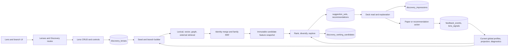

# Discovery scope and learning audit

This is the **2026-09-23 audit baseline** for the combined Discovery workstream.
The [2026-09-24 as-inspected map](discovery-current-state-map.md) supersedes
its source-state claims where this working branch has since been edited. In
particular, durable `discovery_branches`, shared branch resolution, branch-aware
vector retrieval, disabled global channel-yield application, and revised UI
error/freshness behavior are now present as unverified working-tree changes;
the defect ledger below retains their original findings until implementation
is reviewed and verified. Measurements use private
read-only SQLite backups taken on 2026-09-23: production (4,175 papers) and
the isolated dev profile (12,148 papers). Neither backup is part of Git.

## Product boundary

Discovery owns lenses, branches, candidate retrieval, ranking, recommendation
decks, explanation, exposure, and learning from explicitly attributable user
actions. Feed owns deterministic source monitoring; Library owns membership and
organisation; Authors owns identity and follows. Discovery may read those
surfaces through their contracts, but its learned taste must belong to the
specific branch that produced and exposed a suggestion (D26). A new branch
starts from shipped defaults. A lens names a context; it is not a hidden pool of
learned taste shared by its branches.

Preference, visibility, and membership are separate (D6). Dismiss hides a
suggestion and is not negative evidence. Dislike is an explicit negative
verdict. An unseen or merely unacted-on paper is not a negative. The semantic
partition and branch membership are corpus structure; taste may change query
allocation and ordering within a branch, never rewrite that structure. Map
and Signal Lab additive heads remain outside core (D24/D25); learning itself
belongs to Discovery core (D27).

## Current lifecycle and owners

| Transition | Current owner and durable fields | Audit finding |
|---|---|---|
| Create, edit, delete, order lens | `api/routes/lenses.py` → `application/discovery/lens_crud.py`; `discovery_lenses` stores context, channel weights, controls, profile and freshness | A lens is a container and seed context, but global taste is also read during refresh. |
| Resolve seeds and branches | `seed_profile.py` (`_load_seed_papers_for_lens`, `_build_seed_branches`); `_make_branch_id` in `lens_crud.py` | Branches have no durable row. Their ID embeds mutable topic slug and seed-set hash; controls live in lens JSON. |
| Preview | `seed_profile.preview_lens_branches` and `branch_preview.py` | Applies outcome enrichment and automatic lifecycle; cache omits seed and feedback revisions. |
| Refresh | `application/discovery/__init__.py`; retrieval in `retrieval/{lexical,vector,graph,external,merge}.py` | External lane applies manual controls without preview's automatic lifecycle or `auto_weight`; branch queries, global taste queries, and lens-wide lanes coexist. |
| Fusion and candidate features | `retrieval/merge.py`, `features.py`, `scoring_loop.py`; `discovery_ranking_candidates` records reward, exposure, retrieval hits, policy and model versions | Full hits survive in snapshots, while displayed/stored recommendation has only one branch ID even when several contributed. |
| Rank and persist | `ranker.py`, `scoring_loop.py`, `application/discovery/__init__.py`; `suggestion_sets` and `recommendations` | Family weights and channel-yield multipliers are global; one branch's behavior can move another branch's deck. |
| Read and explain | `api/routes/discovery.py`, `api/routes/lenses.py`, `DiscoveryPage.tsx`, `PaperDetailPanel.tsx` | The page can show a global refresh time under a selected lens; fetch failure looks like an empty deck; explanation failure is cached as `null`. |
| Exposure | `discovery_impressions`; frontend `useDiscoveryImpressions.ts` | Exposure is recorded, but historical branch-attributed recommendation rows have no matching impressions in the measured copies. |
| Action | `lens_crud.mark_recommendation_action` → `library.record_paper_feedback` → `feedback_substrate.record_feedback`; `recommendations.user_action`, `feedback_events`, `lens_signals` | Like/love/dislike do not stamp recommendation rows; Dismiss does. The branch outcome aggregator reads those rows and therefore sees the wrong verdicts. |
| Learn | `feedback_substrate.py`, `signal_projection.py`, `discovery/scoring.py`, `channel_yield.py`, `outcome_eval.py` | Global preference profiles and projections are mixed into branch refresh. `paper_action` produces zero affinity delta in one path; a separate projection path learns signed values globally. The family-weight fitter is diagnostic and global. |

The [pipeline reference](discovery-pipeline.md) describes retrieval fusion and
immutable snapshots. This table records the audit baseline; consult the
[as-inspected map](discovery-current-state-map.md) for current working-tree
ownership and the complete lifecycle.

## Evidence volume and granularity

| Measured item | Production copy | Dev copy | Consequence |
|---|---:|---:|---|
| Lenses / recommendations | 1 / 50 | 2 / 264 | Very few independent contexts. |
| Recommendations with branch ID | 4 | 10 | Most deck outcomes cannot be attributed to a branch. |
| Branch-ID rows with explicit positive/negative preference | 0 | 4 saved, 0 dislike | Insufficient to fit branch-local coefficients or entity effects. |
| Branch-ID rows with recorded item impression | no impression table | 0 | Cannot construct an honest exposed contrastive pair from those rows. |
| Feedback events linked to a recommendation ID | 0 | 0 | Existing historical events cannot be assigned to a branch through their event context. Current code now writes that key; historical data do not. |
| Immutable candidate snapshots / selected | absent | 5,289 / 1,700 | Useful for replay and feature coverage, not labels for unseen candidates. |
| Actual item impressions | absent | 211 | Exposure exists in dev, but does not cover the branch-attributed rows. |

Dev candidate snapshots show that individual signal **availability differs
from learned influence**. All 5,289 snapshots have a numeric `projection_author_raw`,
`projection_keyword_raw`, and `projection_tag_raw` field, but all three are
zero. `projection_author_name_raw` varies in 4,035, `projection_topic_raw` in
3,495, `projection_venue_raw` in 4,674, and
`projection_semantic_neighbor_raw` in 2,527. The negative semantic signal is
zero in all 5,289 snapshots despite 40 negatively rated dev papers having
embeddings. Paper keyword metadata is present in 2,811 of 5,075 candidate
rows joined to corpus papers, so a zero keyword projection cannot be explained
as absence of all keyword metadata. Candidate `author_id` is absent in all
5,075 joined rows while 5,069 have author-name metadata; entity ID and name
paths must be audited separately. These are coverage observations, not claims
that the nonzero signals improve ranking.

No honest per-branch or per-entity model can be validated against this tiny,
historically unlinked label set. The first implementation gate is trustworthy
branch identity, provenance, exposure and action linkage; then planted-signal
tests and forward-collected within-branch comparisons can judge fine-grained
effects. Absence of evidence keeps that branch at shipped defaults, rather
than borrowing another branch's preferences.

## Value-level learning contract to establish

### Controls, score and exploration: additional current-state findings

| Control or stage | What current code actually does | Design consequence |
|---|---|---|
| `lens.max_seeds` (500 default; clamped 50–5,000) | `_load_seed_papers_for_lens` truncates global/collection membership by rating then citations, and topic/tag membership by citations. | This changes lens structure and retrieval context, and excludes the long tail. Remove the fixed count; represent every eligible member. |
| Branch temperature | `_resolve_branch_temperature` prefers per-lens override, then global `branches.temperature`, then a mode-based fallback. Since the global default exists, the rank mode usually does not determine temperature. `_build_seed_branches` changes core/explore topic counts and jumps from nearest to farthest cluster at 0.5; query planning also switches a word at 0.4. | It is neither a smooth semantic-distance control nor a deck exploration share. Replace with a measurable reach policy and keep structural resolution independent. |
| Rank `recommendation_mode` | `explore` and `exploit` multiply family weights before normalization; default author and recency are zero, so multipliers on them do nothing. The mode does not change the selector's fixed four random exploration slots. | Remove or unify with the reach policy after measuring impact; do not advertise it as actual exploratory coverage. |
| Branch count and coverage | Branch display defaults to six; external retrieval processes only the first four active branches. Lexical and graph lanes use lens-wide seeds, and graph PPR uses global Library/Loved seeds. | Every active branch needs a nonzero candidate budget and its own browsable, paginated stream. Avoid a shared 50-card ceiling and hidden first-four cutoff. |
| Candidate/deck limits | Each of four retrieval lanes receives the refresh `limit` (50 by default); after full scoring the workflow stages only the top 200 and builds a deck of at most the requested limit. `build_slate` cannot recover a branch absent from that scored top 200. | Replace one global cut with bounded per-branch pools, paginated result persistence and transparent coverage metrics. Bound work and writes per chunk, rather than excluding long-tail branches. |
| Automatic branch lifecycle | Smoothed positive share (six pseudo-observations, 60-day window, 30-day decay) yields 0.3–1.8 allocation weight; at ≤0.65 core/explore topics swap and at ≤0.55 the branch auto-mutes. Cold branches get 1.15. | Selected, sparse outcomes should not erase structural coverage. Retire automatic mute/rotation; constrain adaptation above an explicit exploration floor. |
| Slate exploration | `build_slate` reserves up to four uniform tail picks; MMR/caps fill the rest. This is independent of temperature and branch targets. | Allocate quality-qualified core/adjacent/bridge/far opportunities per branch, then interleave an overview and record realized novelty/distance. |
| Branch preview UI | The local temperature slider is passed on save, but `useBranchPreview` passes only resolution to the preview call. | An unsaved temperature change does not produce a truthful preview. Preview must use the same proposed controls and plan as the next refresh. |
| Rank and learning | Ten families score globally through one profile; `fit_shadow_ranker` runs during refresh but is diagnostic; `signal_tuning` is in-sample diagnostic. Exact value keys are stored provisionally but have no branch-local score effect. | First isolate and simplify relevance, quality, local taste and slate selection; fit only supported local effects, then verify on future exposed comparisons. |

The current `DEFAULT_SIGNAL_WEIGHTS` were fitted on 539 Library papers against
rejected and random corpus papers. That holdout measures a retrospective
Library/corpus separation task, not Discovery's prospective, branch-local
user utility. The source notes that three families were not measurable in the
offline fit. Report this as a shipped prior, not evidence that each family
improves the Discovery deck. Retrieval and slate diversity require separate
evaluation from the ranker's within-pool ordering.

### Acquisition is the primary recall bottleneck

The ordinary lens refresh makes no live source search. Its four local lanes
search the corpus and the 30-day offline `discovery_frontier`; network source
collection occurs in `run_frontier_maintenance`. `build_discovery_frontier`
searches only the six strongest **global Library topics**, 40 results per query,
with a six-year recency bound and a fixed `temperature=0.28`. It also requests
one global Semantic Scholar recommendation set, all-time neighbours for at
most six globally selected papers, and citing works for four top-rated OpenAlex
papers. Bibliographic-coupling backfill is another bounded global path. The
frontier has no lens/branch-specific acquisition plan or coverage ledger.
Branch query variants in refresh search only that already-populated frontier;
they cannot fetch a missing paper. Therefore even perfect branch ranking cannot
recover a relevant unseen paper absent from both corpus and frontier.

`_s2_seed_identifiers` selects up to 150 globally rated/status papers and
currently puts `status='dismissed'` in the Semantic Scholar **negative** seed
list. This conflicts with D6's visibility-only Dismiss meaning. The source
query's global top-topic policy also violates D26's branch-independent taste
once its candidates are presented as branch-driven Discovery. Both need a
canonical branch-local acquisition planner and action semantics repair.

The 50/200 limits are not the only selection boundaries. `source_search` caps
each provider at 25 per query, discards responses after a 20-second frontier
query deadline, and the frontier expires after 30 days. These are valid resource
controls only if the system records each branch's query coverage, source
failure, exhaustion/pagination and age distribution; otherwise a thin deck is
ambiguous between weak relevance and absent acquisition.

The current filter removes Library, globally dismissed/removed, and reading
queue papers for ordinary lenses; collection lenses have different membership
rules. A tracked corpus paper can be a Discovery candidate even if already
surfaced elsewhere. The product should distinguish **new to Library**, **new
to Discovery**, and **not previously seen anywhere** using durable exposure
provenance. These are different novelty claims, and neither should be inferred
from `status` alone.

### Proposed evidence and decision model

At acquisition, preserve provider/query/seed/rank, result page, time and
failure. At rank time, keep these concepts separate:

1. **Eligibility and safety:** canonical identity, lens membership/exclusion,
   retraction and other hard facts. Missing dates and metadata are unknown,
   not negative evidence.
2. **Branch relevance:** semantic, lexical, citation and entity relations to
   that branch's *complete* structural membership; calibrate and fuse correlated
   views without paying the same fact twice.
3. **Paper quality:** intrinsic evidence such as field/year-normalized citation
   impact, study type and metadata confidence. Avoid raw citation popularity as
   a universal relevance proxy or a blanket penalty on recent work.
4. **Branch taste:** signed, regularized effects for exact values and compatible
   semantic directions learned only from that branch's impressed explicit
   outcomes. The branch's corpus shape is context, not learned preference.
5. **Slate utility:** novelty, coverage of branch facets, source/author/venue
   diversity and exploration distance. Apply after candidate scoring and record
   realized opportunity and inclusion probabilities.

Use a single candidate × branch feature record; family fusion is a retrieval
signal, not another taste reward. One rank formula must expose each calibrated
contribution, availability, support, uncertainty and version. Learn a weight
only when a source of independent variation identifies its incremental effect.
Interactions such as author × topic or method × population require stronger
support than single-value effects; otherwise shrink them to zero. A candidate
found by multiple branches can have several scores and one selected displayed
context, with the alternatives retained as provenance.
Because one paper bundles many authors, topics, phrases and methods, a bare
Like/Dislike rarely identifies which tiny value caused the judgment. Matched
visible contrasts reduce this confounding; an optional reason attached to an
explicit verdict on the card could identify a value directly. It must use the
canonical branch action path and must never reinterpret Dismiss as a Dislike.

The current ten-family score has several interactions to resolve before
reweighting: semantic similarity and the semantic retrieval rank are related;
lexical overlap and lexical retrieval rank are related; citation count, graph
proximity and citation retrieval share a family or pipeline; author/venue/topic
affinities overlap with the feedback/preference projections. The ranker groups
some atoms with `max` or `noisy_or` and imputes missing families to a corpus
prior, which avoids simple missing-data punishment but does not establish that
these families are independent or branch-scoped. Default topic, author and
recency family weights are zero; venue remains 0.05, citation 0.12, retrieval
0.14, feedback 0.09, preference 0.09, and text similarity 0.51 split 87%/13%
between semantic/lexical. Thus the nominally broad control surface mostly
reorders by semantic proximity and overlapping global taste. The previous
offline AUC fit cannot settle whether that combination finds *unseen useful*
papers; compare source, feature and family ablations on acquisition and
exposed outcomes separately.

### Manifold hypothesis, without a second map product

The useful object is a sparse high-dimensional neighbourhood graph over
papers, with semantic similarity and separately typed citation edges. It can
support local neighbourhood retrieval, boundary/bridge discovery, branch
cohesion checks and uncertainty-aware exploration. A branch is a stable region
on this graph; its taste can be modelled as a **local signed field** over exact
features and nearby semantic directions. Smoothing must stay inside that
branch and decay with graph distance and evidence uncertainty. It must not
change paper coordinates or structural membership, and it must not spread a
verdict into another branch (D26).

Do not rank by distance in a 2-D UMAP layout. [UMAP](https://arxiv.org/abs/1802.03426)
reduces high-dimensional neighbourhoods; its coordinates are useful for
visualisation/partition diagnostics, but the source semantic
distance, sparse graph relationships and calibrated local evidence should be
the ranking inputs. A [diffusion-map](https://www.math.ucdavis.edu/~strohmer/courses/270/diffusion_maps.pdf)
or manifold-distance candidate generator
is a challenger against direct kNN, citation traversal and simple branch
centroids. Adopt it only if it finds additional relevant unseen papers at an
acceptable CPU/RAM cost and with stable branch boundaries. The Map UI remains
outside Discovery core (D24).

SPECTER2 already uses [citation-derived triplet contrast](https://github.com/allenai/SPECTER2)
in its upstream model
training. ALMa currently uses its representations for structure/similarity;
that training does not constitute personal contrastive taste learning. The
branch-local fitter has not been wired. ICA is absent from the Discovery path.
It may expose [interpretable independent axes](https://aclanthology.org/2023.emnlp-main.283/)
from text or embeddings, but it
does not label user preference. Compare it offline to sparse text factors,
cluster descriptors and a direct within-branch positive-minus-negative vector;
adopt only if axes remain stable and improve held-out exposed ranking beyond
the simpler model. Lack of valid branch pairs currently prevents an accuracy
claim for any of these alternatives.

| Dimension | Present signal | Required branch-local contrast |
|---|---|---|
| Author | Names, follows, coauthor graph, global affinity/projection; stable `author_id` absent in sampled candidate rows | Exact identified author where possible; name only with identity confidence. Compare explicitly liked and disliked **exposed** papers in the same branch, accounting for topic and coauthor spillover. |
| Venue | Journal affinity and global exact-venue projection | Compare venue while holding topic/period roughly fixed; shrink sparse venues to neutral. |
| Topic | Topic overlap and global term projection | Distinguish exact topic from broad branch seed membership; update only when explicit within-branch evidence separates it. |
| Keyword or phrase | Candidate metadata exists, but sampled keyword projection is identically zero | Preserve normalised phrase identity in snapshots; compare it against matched alternatives within one branch, avoiding token-level false matches. |
| Semantic direction or cluster | Vector similarity, exemplars, global signed neighbor projection; sampled negative semantic signal zero | Contrast exposed positive and explicit negative embeddings within one branch. Keep exploration; never change corpus partition membership from taste. |
| Method, population, domain, type | Some text/keyword/work-type metadata, no separate estimator evidenced in current map | First define observable, reproducible feature extraction and coverage; fit only identifiable values with independent outcomes. |
| Recency and citations | Available numeric families and global weight fitting | Conditional within-branch comparisons; do not infer preference from a top-ranked, unexposed sample. |

One canonical, versioned value snapshot should feed fit, rank, stored replay and
explanation. Every learned change needs explicit provenance, support,
uncertainty, cold-start shrinkage and a branch reset. Retrieval breadth and
ranking quality need separate measurements: re-ranking cannot recover a paper
that no retrieval lane found. A metric/contrastive embedding model is a
challenger only after simpler per-value and pairwise estimators are tested on
identifiable evidence.

## Defect ledger (open at audit start)

| ID | Severity | Evidence / owner | Violated contract |
|---|---|---|---|
| D92-01 | P0 | `channel_yield.py` pools outcome evidence globally; `application/discovery/__init__.py` applies it to every lens. `ranker.resolve_family_weights` and `discovery/scoring.py` also read global learned taste. | D26 branch isolation. |
| D92-02 | P0 | `lens_crud.mark_recommendation_action` does not stamp like/love/dislike on recommendations; `_aggregate_branch_outcomes` reads those stamps and treats Dismiss as negative. | D6 and truthful branch learning. |
| D92-03 | P0 | `feedback_substrate._affinity_delta` has no `paper_action` case; canonical paper actions increase profile counts with zero delta. | Counts must represent real tuning evidence. |
| D92-04 | P0 | `retrieval/external.py` and `retrieval/merge.py` collapse several branch hits to one stored `branch_id`; current historical data have little branch attribution. | Causal attribution and honest explanation. |
| D92-05 | P1 | `seed_profile.preview_lens_branches` applies automatic outcome/lifecycle changes that external refresh does not; its cache key omits seed and action revisions. | Preview/refresh parity and freshness. |
| D92-06 | P1 | `_make_branch_id` includes mutable slug; `_load_branch_seed_history` calls recommendation outputs historical seeds. | Durable branch identity and control lineage. |
| D92-07 | P2 | Legacy Insights branch-action route resolves lenses via past recommendations, so it cannot control a new previewed branch. The active Branch Explorer instead writes `lens.branch_controls` through `PUT /lenses/{id}`; audit whether the duplicate route should be removed. | One owner for branch controls and no dead route. |
| D92-08 | P1 | `DiscoveryPage.tsx` reapplies `?lens=` whenever selected lens changes, so a deep link can trap lens selection. Recommendation errors appear as empty decks; explanation errors cannot retry; selected lens uses global freshness. | Navigation and truthful status. |
| D92-09 | P2 | `DiscoveryPage.tsx` offers selection/Select All with no bulk consumer and fabricates January 1 for year-only recent sorting. | Useful controls and truthful dates. |
| D92-10 | P0 | `retrieval/vector.py` builds a second cluster system with positional IDs (`vector_branch_0`, etc.), independent of the lens branches produced by `seed_profile.py`; other local lanes are lens-wide. | Every ranking candidate needs a stable branch context, not an unrelated query index or first-hit branch. |
| D92-11 | P0 | `frontier.build_discovery_frontier` queries only six strongest global Library topics and globally selected S2/OpenAlex seed papers; refresh branch queries search this prefetched pool only. | A branch cannot discover unseen external papers outside a narrow global frontier; acquisition recall must be branch-local and measured before ranking. |
| D92-12 | P0 | `frontier._s2_seed_identifiers` includes `status='dismissed'` as an S2 negative seed. | D6 says Dismiss is visibility-only; it cannot train an external recommendation request as negative taste. |

Fixes should be checked at the primitive that owns each contract. Each ledger
entry needs reproduction, regression guard and live recheck before closure.

To refresh the aggregate evidence counts on a consistent SQLite copy, run
`python scripts/discovery_evidence_audit.py --db /path/to/copy.db`. The command
opens the copy immutable and read-only, writes no database state, and prints
JSON counts plus numeric feature availability, nonzero counts, distinct counts
and variance. It does not print paper text, entity names or identifiers. An
absent table reports `present: false`; never run it against a live WAL database,
because immutable reads do not include uncheckpointed WAL changes.
